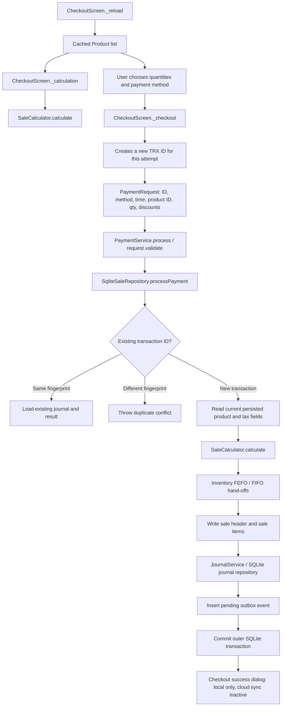

# Prompt 08 — POS Checkout Transaction Audit

**Date:** 2026-10-20 (Asia/Jakarta)  
**Workstream:** Prompt 08 only — cart calculation, checkout request/result semantics, product eligibility, and local sale-posting orchestration.  
**Repository:** `berkah-pos/Berkahtigaputeri`  
**Audited revision:** `main` / `371b7fdf0bf672b37ceb1023e647f114221bf797`  
**Scope status:** **PARTIAL — source review complete; runtime tests NOT RUN in this audit.**  
**Change boundary:** This report is the only intended change in this branch. No checkout, pricing, inventory, journal, outbox, database, workflow, dependency, or infrastructure implementation was changed.

## 1. Executive assessment

The Flutter checkout currently follows a coherent **local** posting path: it loads a product catalogue, calculates a cart preview in memory, creates a new transaction ID at the start of checkout, sends product IDs and quantities to `PaymentService`, re-reads product price and tax classification inside `SqliteSaleRepository`, then writes sale, sale lines, inventory changes, reservation state, journal, and a pending outbox event inside one outer SQLite transaction. The visible success dialog says the sale is stored on-device and cloud sync is not active.

The most important gaps are at the checkout boundary, not a proven defect in FEFO/FIFO or journal algorithms:

1. The displayed cart total is calculated from cached product objects, while final posting uses current persisted product price/tax status. No price/version snapshot or confirmation handles a change between preview and commit.
2. The screen generates a fresh transaction ID each time `_checkout()` is called and does not persist it before posting. Repository-level replay protection works only when the same ID and request fingerprint are reused; a process interruption after commit but before the UI confirms the result can leave an ambiguous sale and a subsequent attempt can use a different ID.
3. Existing rollback tests prove an insufficient-stock rejection before mutation, but do not exercise failures after earlier cart lines have changed inventory or after the sale/journal writes have started.
4. The product schema/model has a review flag but no active/disabled status, so the requested “product activity” eligibility check is not represented in the source contract.
5. Payment method is persisted and mapped to a cash/QRIS/bank journal account, but there is no settlement status or provider confirmation contract. The current UI does not claim gateway verification; the audit cannot establish that selected QRIS/transfer means funds were actually received.
6. Zero-value/free-sale behaviour and the fixed 11% PPN calculation lack an explicit versioned business-policy contract in the examined checkout request/storage model.

**Release interpretation:** The local-only checkout path is present in source. This is not evidence that the current exact main SHA has passing Flutter tests, that cloud synchronization works, or that a production release is ready. Main SHA `371b7fdf...` has no status checks reported by the combined-status API. Workflow runs found for adjacent parent SHAs are not substitutes for current-head checkout tests.

## 2. Authority and protected constraints used

- `AGENTS.md`: evidence classes, branch/PR-only changes, current-main inspection, and report truthfulness.
- `docs/permanent/DOC_00_CANONICAL_ARCHITECTURE_DECISION.md`: configuration contract is `GLOBAL → TEMPLATE → TENANT → SERVICE → DEVICE`, with exactly 352 canonical entries; unrelated to checkout code changes and preserved.
- `docs/permanent/ADR-2026-10-17-OWNER-KVM2-LARAVEL-POSTGRESQL-NO-SUPABASE.md`: accepted Laravel Central API + PostgreSQL 17 target and no-Supabase policy. No Supabase project/product was accessed.
- `docs/permanent/DOC_00_MASTER_ROADMAP.md` and `docs/permanent/DOC_14_KVM2_ISOLATED_TENANT_ARCHITECTURE.md`: source presence and planning documents do not establish executed API, tenant-isolation, deployment, or recovery gates.
- `docs/permanent/DOC_12_SAAS_DATABASE_OFFLINE_ARCHITECTURE_AND_AGENT_PROTOCOL.md`: local checkout must write its sale and durable outbox atomically; amount arithmetic uses integer Rupiah; retries must reuse a stable idempotency identity; cloud acknowledgement is only after server acceptance; FEFO physical allocation remains distinct from FIFO costing.
- `docs/permanent/DOC_13_UNIFIED_POS_APP_INTEGRATION_REPORT.md`: cloud sync and several release tests are historically documented as incomplete; current source was checked instead of assuming old report statements remained current.

## 3. Call graph: cart to durable local result

### Principal source edges

| Edge | Source evidence | What it proves / does not prove |
|---|---|---|
| Catalogue → preview | [`checkout_screen.dart`](https://github.com/berkah-pos/Berkahtigaputeri/blob/371b7fdf0bf672b37ceb1023e647f114221bf797/pos-app/lib/features/pos/checkout_screen.dart#L65-L84) | Preview is calculated from the screen's loaded `_products` list. It does not prove those values remain current until posting. |
| User action → request | [`checkout_screen.dart`](https://github.com/berkah-pos/Berkahtigaputeri/blob/371b7fdf0bf672b37ceb1023e647f114221bf797/pos-app/lib/features/pos/checkout_screen.dart#L122-L150), [`payment_service.dart`](https://github.com/berkah-pos/Berkahtigaputeri/blob/371b7fdf0bf672b37ceb1023e647f114221bf797/pos-app/lib/features/pos/checkout/payment_service.dart#L34-L103) | The request transports transaction ID, method, time, IDs, quantities, discounts and timezone; no displayed-price snapshot or product-price revision is included. |
| Validation → repository | [`payment_service.dart`](https://github.com/berkah-pos/Berkahtigaputeri/blob/371b7fdf0bf672b37ceb1023e647f114221bf797/pos-app/lib/features/pos/checkout/payment_service.dart#L63-L103), [`sqlite_sale_repository.dart`](https://github.com/berkah-pos/Berkahtigaputeri/blob/371b7fdf0bf672b37ceb1023e647f114221bf797/pos-app/lib/features/pos/checkout/sqlite_sale_repository.dart#L31-L105) | Request validation and persisted product lookups are source-visible. Tests were not run on this audit's exact SHA. |
| Atomic post | [`pos_database.dart`](https://github.com/berkah-pos/Berkahtigaputeri/blob/371b7fdf0bf672b37ceb1023e647f114221bf797/pos-app/lib/core/database/pos_database.dart#L60-L72), [`sqlite_sale_repository.dart`](https://github.com/berkah-pos/Berkahtigaputeri/blob/371b7fdf0bf672b37ceb1023e647f114221bf797/pos-app/lib/features/pos/checkout/sqlite_sale_repository.dart#L190-L340) | `PosDatabase.transaction` delegates to an exclusive SQLite transaction; the repository writes sale, lines, journal and outbox inside its callback. Source-level transaction wiring is present; injected late-failure rollback is not thereby proven. |
| Journal participates in outer transaction | [`sqlite_journal_repository.dart`](https://github.com/berkah-pos/Berkahtigaputeri/blob/371b7fdf0bf672b37ceb1023e647f114221bf797/pos-app/lib/features/accounting/repositories/sqlite_journal_repository.dart#L14-L35), [`journal_service.dart`](https://github.com/berkah-pos/Berkahtigaputeri/blob/371b7fdf0bf672b37ceb1023e647f114221bf797/pos-app/lib/features/accounting/services/journal_service.dart#L18-L77) | When the repository receives the outer transaction executor, its nested transaction wrapper reuses that executor. Journal service validates balanced known-account entries before posting. |
| Local success UX | [`checkout_screen.dart`](https://github.com/berkah-pos/Berkahtigaputeri/blob/371b7fdf0bf672b37ceb1023e647f114221bf797/pos-app/lib/features/pos/checkout_screen.dart#L140-L168) | UI reports sale saved locally and explicitly states cloud sync is inactive. It does not claim gateway settlement or cloud acceptance. |
| API hand-off | [`routes/api.php`](https://github.com/berkah-pos/Berkahtigaputeri/blob/371b7fdf0bf672b37ceb1023e647f114221bf797/routes/api.php#L1-L12) | Current route source exposes only `GET /api/v1/platform-health`; no sale-sync endpoint appears in this file. Cloud sync is explicitly out of scope for Prompt 08 and remains a Prompt 11 blocker. |

## 4. Calculation contract and source fixtures

### Current source behaviour

- `SaleCalculator` uses integer amounts and a constant `ppnRatePercent = 11` ([source lines 72–172](https://github.com/berkah-pos/Berkahtigaputeri/blob/371b7fdf0bf672b37ceb1023e647f114221bf797/pos-app/lib/features/pos/cart/sale_calculator.dart#L72-L172)).
- Empty cart and negative transaction discount are rejected; aggregate gross must be greater than zero. Quantity must be greater than zero; unit price and item discount may be zero but not negative; item discount may not exceed gross ([source lines 80–110 and 237–260](https://github.com/berkah-pos/Berkahtigaputeri/blob/371b7fdf0bf672b37ceb1023e647f114221bf797/pos-app/lib/features/pos/cart/sale_calculator.dart#L80-L110)).
- Transaction-level discount is allocated proportionally against each line's net amount, with largest remainders assigned deterministically by original line index. PPN is calculated once from the invoice's aggregated taxable DPP, not from exempt DPP.
- Integer rounding is half-up in the helper implementation. These findings describe the current source, not a legal/tax-policy verification.
- The calculation and payment requests do not contain a tax-policy version/effective-date identifier. The source uses a fixed 11% rate; the applicable rate basis and cutover policy need confirmation from the accounting/tax owner.

### Existing source fixtures (present, not executed during this audit)

| Fixture/source test | Input → expected result | Evidence and limitation |
|---|---|---|
| Single taxable line with two discounts | Gross Rp100,000; item discount Rp10,000; transaction discount Rp10,000; taxable DPP Rp80,000; PPN Rp8,800; total Rp88,800 | [`sale_calculator_test.dart`](https://github.com/berkah-pos/Berkahtigaputeri/blob/371b7fdf0bf672b37ceb1023e647f114221bf797/pos-app/test/pos/cart/sale_calculator_test.dart#L8-L30). Fixture exists; exact-head execution not verified. |
| Mixed taxable and exempt cart | Gross Rp150,000; transaction discount Rp15,000 allocated Rp10,000 taxable / Rp5,000 exempt; taxable DPP Rp90,000; exempt DPP Rp45,000; PPN Rp9,900; total Rp144,900 | [`sale_calculator_test.dart`](https://github.com/berkah-pos/Berkahtigaputeri/blob/371b7fdf0bf672b37ceb1023e647f114221bf797/pos-app/test/pos/cart/sale_calculator_test.dart#L31-L61). Fixture covers exempt DPP and allocation; it does not prove current statutory tax policy. |
| Deterministic remainder | Three equal net lines at Rp100; transaction discount Rp1 allocated `[1,0,0]`; DPP Rp299; PPN Rp33 | [`sale_calculator_test.dart`](https://github.com/berkah-pos/Berkahtigaputeri/blob/371b7fdf0bf672b37ceb1023e647f114221bf797/pos-app/test/pos/cart/sale_calculator_test.dart#L62-L99). |
| PPN rounding | DPP 4 → PPN 0; 5 → 1; 999 → 110; 1,000 → 110 | [`sale_calculator_test.dart`](https://github.com/berkah-pos/Berkahtigaputeri/blob/371b7fdf0bf672b37ceb1023e647f114221bf797/pos-app/test/pos/cart/sale_calculator_test.dart#L100-L106). |
| Discount beyond net | Transaction discount above the remaining line net throws `SaleCalculationException` | [`sale_calculator_test.dart`](https://github.com/berkah-pos/Berkahtigaputeri/blob/371b7fdf0bf672b37ceb1023e647f114221bf797/pos-app/test/pos/cart/sale_calculator_test.dart#L107-L124). |

### Calculation cases still required

- Empty request/cart; blank product ID; quantity 0 and negative; negative unit price and negative discounts; item discount greater than line gross; transaction discount exactly equal to net; and full discount resulting in a zero payable total.
- Zero-priced line mixed with paid lines; its stock/COGS/journal treatment must follow an explicit free-item/promotion rule.
- Multi-line discount allocation where more than one largest-remainder tie exists, and a larger supported integer amount boundary to detect overflow under the Dart target.
- Product tax classification and price changed after cart preview but before submit; explicit agreement on whether to refresh, reject/reconfirm, or lock a versioned quote.
- Tax-exempt-only and mixed carts at each approved tax-policy effective date/version.

## 5. Transaction boundary map

| Posting step | Current implementation | Transaction/evidence interpretation |
|---|---|---|
| Duplicate transaction lookup | Query `sales.transaction_id`; compare stored fingerprint before new writes | Source-verified in [repository lines 31–72](https://github.com/berkah-pos/Berkahtigaputeri/blob/371b7fdf0bf672b37ceb1023e647f114221bf797/pos-app/lib/features/pos/checkout/sqlite_sale_repository.dart#L31-L72). Same fingerprint returns prior sale and journal; different fingerprint throws before new posting work. |
| Product resolution/eligibility | Read product rows from SQLite; reject missing product and `requires_review=1`; read persisted price, exemption and stock | Source-verified in [repository lines 73–130](https://github.com/berkah-pos/Berkahtigaputeri/blob/371b7fdf0bf672b37ceb1023e647f114221bf797/pos-app/lib/features/pos/checkout/sqlite_sale_repository.dart#L73-L130). No activity/status attribute exists in the product model/schema. |
| Inventory allocation / stock decrement | FEFO physical allocations, FIFO costing, lot and cost-layer changes, stock decrement, reservation commit | Calls are made within the outer transaction. Algorithm correctness, race edge cases and acceptance remain owned by Prompt 09; this report does not approve those algorithms. |
| Sale header and items | Writes totals, payment method and each line's price/discount/DPP/COGS | Source-visible in [repository lines 190–294](https://github.com/berkah-pos/Berkahtigaputeri/blob/371b7fdf0bf672b37ceb1023e647f114221bf797/pos-app/lib/features/pos/checkout/sqlite_sale_repository.dart#L190-L294). |
| Journal | Calls `JournalService.post` with sales, discount, PPN and COGS/inventory lines using the outer transaction executor | Shared boundary and double-entry validation are source-visible; account policy/immutability/audit ownership remains Prompt 10. |
| Outbox | Writes one `pending` event before leaving the same outer transaction | Source-visible in [repository lines 307–326](https://github.com/berkah-pos/Berkahtigaputeri/blob/371b7fdf0bf672b37ceb1023e647f114221bf797/pos-app/lib/features/pos/checkout/sqlite_sale_repository.dart#L307-L326). Payload is a compact summary (`saleId`, `transactionId`, `businessDate`, `grandTotal`, `ppnAmount`, `paymentMethod`) rather than full sale lines; payload/rehydration and delivery contract belong Prompt 11. |
| Commit and UX acknowledgement | Outer `PosDatabase.transaction` returns result, then screen clears cart and shows local-save dialog | The code waits for repository completion before success UI. A crash after DB commit but before UI/callback is still an ambiguous-outcome case unless the request key/cart intent is persisted across process restart. |

## 6. Findings

Severity convention: **P1** = material transactional/business risk requiring closure before release acceptance; **P2** = significant eligibility/policy gap requiring a decision and tests; **P3** = lower-priority hardening/coverage improvement. Confidence is confidence in the source observation, not certainty that a production incident has occurred.

### POSE-08-01 — Preview/commit price and tax can diverge

- **Severity / confidence:** P1 / High.
- **Evidence:** `CheckoutScreen._calculation` uses the in-memory loaded `_products` to display DPP/PPN/total; `PaymentRequest` only carries product ID and quantity; the repository then reloads each product from SQLite and calculates from the persisted `price` and `ppn_exempt`. There is no quote ID, product price version, expected price, or stale-preview rejection. See [screen lines 65–84 and 122–150](https://github.com/berkah-pos/Berkahtigaputeri/blob/371b7fdf0bf672b37ceb1023e647f114221bf797/pos-app/lib/features/pos/checkout_screen.dart#L65-L150), [request contract lines 34–60](https://github.com/berkah-pos/Berkahtigaputeri/blob/371b7fdf0bf672b37ceb1023e647f114221bf797/pos-app/lib/features/pos/checkout/payment_service.dart#L34-L60), [repository lines 73–115](https://github.com/berkah-pos/Berkahtigaputeri/blob/371b7fdf0bf672b37ceb1023e647f114221bf797/pos-app/lib/features/pos/checkout/sqlite_sale_repository.dart#L73-L115).
- **Failure scenario:** Catalogue values change after the screen's last reload and before checkout (e.g. another screen/process updates price or tax-exemption status). The cashier sees one total while durable posting uses another.
- **Business impact:** Incorrect customer charge/receipt expectation and possible tax/accounting discrepancy; a source re-read prevents trusting stale UI values but does not inform the cashier of the changed total.
- **Required acceptance test:** Load a cart and record preview values, update the persisted product price and tax exemption before submission, then submit. Pass only if the design deterministically rejects/requires user reconfirmation or uses a documented immutable versioned quote; assert displayed and committed totals/tax match the confirmed amount.
- **Handoff:** Checkout/request contract owner (Prompt 08); product price revision and catalogue semantics may require Prompt 07/catalog owner. Do not silently change inventory/accounting algorithms.

### POSE-08-02 — Per-attempt transaction ID prevents durable retry identity

- **Severity / confidence:** P1 / High.
- **Evidence:** `CheckoutScreen._checkout()` creates `TRX-<current UTC microseconds>` on every invocation and keeps it only in a local variable. Repository replay logic correctly recognizes same ID + same fingerprint and rejects same ID + different fingerprint, but the screen does not persist/reuse the ID. See [screen lines 122–150](https://github.com/berkah-pos/Berkahtigaputeri/blob/371b7fdf0bf672b37ceb1023e647f114221bf797/pos-app/lib/features/pos/checkout_screen.dart#L122-L150) and [repository lines 31–72, 809–852](https://github.com/berkah-pos/Berkahtigaputeri/blob/371b7fdf0bf672b37ceb1023e647f114221bf797/pos-app/lib/features/pos/checkout/sqlite_sale_repository.dart#L31-L72).
- **Failure scenario:** SQLite commit completes but app termination/result-delivery failure happens before the user receives the dialog. After restart, the in-memory cart and old request ID are gone; re-creating the cart invokes checkout with a new ID, which repository idempotency cannot equate to the earlier business intent.
- **Business impact:** Duplicate local sale, stock decrement, journal and outbox event are possible after an ambiguous outcome and manual retry. This is a failure mode, not evidence that duplicate sales have already occurred.
- **Required acceptance test:** Inject app interruption immediately after SQLite commit and before UI success, relaunch, retry the pending checkout intent, and assert exactly one sale, one set of sale items, one journal, one stock/cost movement set and one outbox event. The request ID/idempotency key must be durably saved before the first attempt and reused for retries; changed payload under the same key must return an explicit conflict without mutation.
- **Handoff:** Prompt 07 for durable local intent/recovery storage; Prompt 08 owns request identity and retry semantics; Prompt 11 owns replay/acknowledgement across cloud-sync retries.

### POSE-08-03 — Product activity/disabled state is absent from eligibility contract

- **Severity / confidence:** P2 / High.
- **Evidence:** Product schema contains `id`, SKU, barcode, name, non-negative price/stock, tax flag, expiry fields and `requires_review`, but no `active` or status column; `Product` has no activity field. Checkout only rejects missing rows and products requiring review. See [product schema lines 96–107](https://github.com/berkah-pos/Berkahtigaputeri/blob/371b7fdf0bf672b37ceb1023e647f114221bf797/pos-app/lib/core/database/pos_database.dart#L96-L107), [product model lines 8–38](https://github.com/berkah-pos/Berkahtigaputeri/blob/371b7fdf0bf672b37ceb1023e647f114221bf797/pos-app/lib/features/products/models/product.dart#L8-L38) and [checkout resolution lines 73–105](https://github.com/berkah-pos/Berkahtigaputeri/blob/371b7fdf0bf672b37ceb1023e647f114221bf797/pos-app/lib/features/pos/checkout/sqlite_sale_repository.dart#L73-L105).
- **Failure scenario:** The business needs to retire/disable an item without deleting historical product references, but there is no disabled state that checkout can enforce.
- **Business impact:** A product intended to be unavailable can remain selectable/saleable because “active” is not modelled.
- **Required acceptance test:** Mark a product inactive while retaining historical sales and inventory references; catalogue may display it as unavailable but checkout must fail before any sale, stock, journal or outbox write. Include reactivation and old-sale-history reads.
- **Handoff:** Prompt 08 owns checkout eligibility; Prompt 07/product persistence owner needs to add or formally reject an active-state data contract; Prompt 09 owns stock/lot states and must not be repurposed as a product active flag.

### POSE-08-04 — Full-discount / zero-payable sale policy is unspecified

- **Severity / confidence:** P2 / High for source behavior; Medium for whether behavior is a defect.
- **Evidence:** Price 0 is accepted; an item discount may equal line gross; transaction discount may equal remaining net; the calculator rejects only aggregate gross `<= 0` and does not require `grandTotal > 0`. The journal builder omits the payment debit when grand total is zero, while still posting sales/discount lines and inventory COGS effects where present. See [calculator validation and totals](https://github.com/berkah-pos/Berkahtigaputeri/blob/371b7fdf0bf672b37ceb1023e647f114221bf797/pos-app/lib/features/pos/cart/sale_calculator.dart#L80-L170) and [journal builder](https://github.com/berkah-pos/Berkahtigaputeri/blob/371b7fdf0bf672b37ceb1023e647f114221bf797/pos-app/lib/features/pos/checkout/sqlite_sale_repository.dart#L708-L782).
- **Failure scenario:** A nonzero-gross sale is fully discounted to zero, or a free item is included in a paid cart. Code accepts some such cases without an explicit promotion/free-item policy test.
- **Business impact:** The behavior may be legitimate, but its allowed states and journal/tax/COGS treatment are not demonstrated. An undocumented edge case is not safe to declare correct.
- **Required acceptance test:** Have the accounting/product owner choose whether a zero-payable sale and free line are allowed. Test allowed and rejected variants, including stock decrement, discount account, revenue, PPN, COGS, balanced journal and receipt totals. If not allowed, reject before mutation.
- **Handoff:** Prompt 10 for journal policy; Prompt 09 for stock/COGS side-effects; Prompt 08 for calculation/request validation.

### POSE-08-05 — Payment method is not settlement evidence

- **Severity / confidence:** P2 / High for the representation gap.
- **Evidence:** UI options are Tunai, QRIS, Transfer Bank ([screen dropdown](https://github.com/berkah-pos/Berkahtigaputeri/blob/371b7fdf0bf672b37ceb1023e647f114221bf797/pos-app/lib/features/pos/checkout_screen.dart#L280-L315)). `PaymentRequest`/result carry the selected enum but no gateway response or settlement proof ([payment contract](https://github.com/berkah-pos/Berkahtigaputeri/blob/371b7fdf0bf672b37ceb1023e647f114221bf797/pos-app/lib/features/pos/checkout/payment_service.dart#L8-L159)); the sales schema stores only `payment_method`, with no settlement state/provider reference ([schema](https://github.com/berkah-pos/Berkahtigaputeri/blob/371b7fdf0bf672b37ceb1023e647f114221bf797/pos-app/lib/core/database/pos_database.dart#L399-L420)). The journal debits the mapped method account from the selected value.
- **Failure scenario:** Operator chooses QRIS or transfer in the dropdown and completes checkout without any documented gateway or receipt confirmation step.
- **Business impact:** Selected tender/method can be read downstream as if money were received even though this audit finds no settlement-proof field in the local contract. The UI does not currently claim a gateway verification, and this report does not assert that live payments were incorrectly posted.
- **Required acceptance test:** Explicitly choose the product policy for manually confirmed tender. Test that method selection and payment settlement status remain separate: no gateway-confirmed status without provider evidence; any manually accepted QRIS/transfer must be labelled and audited per approved procedure. Test payment pending/failed/confirmed state mapping if a provider is ever selected.
- **Handoff:** Prompt 10 for accounting classification; payment/provider owner for any future settlement integration. Do not add a provider or make a billing choice as part of Prompt 08.

### POSE-08-06 — Atomic rollback is source-wired but not fully proven by current tests

- **Severity / confidence:** P1 / High confidence that the current rollback test does not cover a late failure; no claim that source transaction wiring is broken.
- **Evidence:** Sale, lines, stock/inventory movements, journal and outbox are written within the exclusive outer SQLite transaction ([transaction helper](https://github.com/berkah-pos/Berkahtigaputeri/blob/371b7fdf0bf672b37ceb1023e647f114221bf797/pos-app/lib/core/database/pos_database.dart#L60-L72), [sale/journal/outbox sequence](https://github.com/berkah-pos/Berkahtigaputeri/blob/371b7fdf0bf672b37ceb1023e647f114221bf797/pos-app/lib/features/pos/checkout/sqlite_sale_repository.dart#L190-L340)). Existing insufficient-stock test submits one line where requested stock already exceeds persisted stock; that branch throws before mutating inventory or inserting the sale. [Test lines 353–406](https://github.com/berkah-pos/Berkahtigaputeri/blob/371b7fdf0bf672b37ceb1023e647f114221bf797/pos-app/test/pos/checkout/payment_service_test.dart#L353-L406).
- **Failure scenario:** A later cart line fails after an earlier line has already updated lot/cost-layer/stock rows, or an injected write failure occurs after a sale header or journal insert but before outbox completion.
- **Business impact:** Atomicity is a critical accounting/stock invariant. The implementation is structured for rollback, but the cited negative test does not evidence rollback after partial in-transaction work.
- **Required acceptance test:** (1) Use two lines: first line succeeds in FEFO/FIFO and stock decrement; second line fails at a later eligibility/allocation/write step. (2) Inject a deterministic insert/update error after the sale header and again after journal writes but before outbox completion. For every failure assert no sale/header/items, journal/lines, inventory/stock movements, lot/cost-layer decrement, reservation transition, or outbox row remains; counts and all balances return to baseline. Also run the successful equivalent and verify exactly one complete set of records.
- **Handoff:** Prompt 08 owns the transaction-level acceptance test; Prompt 09 provides inventory fixtures/failure injection; Prompt 10 provides journal invariants; Prompt 11 validates outbox row lifecycle.

## 7. Failure / rollback / idempotency matrix

| Scenario | Source disposition | Required expected outcome | Current evidence state |
|---|---|---|---|
| Empty cart / blank product ID | Explicit request/calculator validation | Reject before DB writes | **SOURCE-VERIFIED**; edge test not found in the inspected test files; exact-head run not performed. |
| Quantity ≤ 0 / negative price / negative discount / discount > gross | Request/calculator rejects listed invalid values; zero price and full discount remain allowed | Reject invalid inputs; explicitly define free-line/full-discount handling | **SOURCE-VERIFIED**; broader negative matrix **NOT TEST-EXECUTED** in this audit. |
| Product ID not found | Repository throws product-not-found before posting | No mutation | **SOURCE-VERIFIED**; current-main execution not verified. |
| Product requires review | Repository rejects before inventory/sale writes | No sale/journal/outbox; inventory remains untouched | Source test exists [here](https://github.com/berkah-pos/Berkahtigaputeri/blob/371b7fdf0bf672b37ceb1023e647f114221bf797/pos-app/test/pos/checkout/unreviewed_product_checkout_test.dart#L10-L60); **NOT RUN** on audited SHA. |
| Product inactive/disabled | No activity field/eligibility branch found | Reject prior to any transaction side effect | **GAP — no implementation contract**. |
| Stale price/tax status between preview and posting | Preview cached, repository re-reads DB; no quote/version comparison | Require confirmation or versioned quote so UI and saved totals match | **GAP — source-verified mismatch path; test missing**. |
| Insufficient stock detected before any write | Repository check throws; test expects stock/sale/journal/outbox unchanged | No writes | Test source exists [here](https://github.com/berkah-pos/Berkahtigaputeri/blob/371b7fdf0bf672b37ceb1023e647f114221bf797/pos-app/test/pos/checkout/payment_service_test.dart#L353-L406); **NOT RUN** here. |
| Failure after earlier lines or after journal before outbox | Outer transaction is present; no injected late-failure test found in inspected suite | Roll back all sale, inventory, reservation, journal, and outbox writes | **NOT VERIFIED** — acceptance test required. |
| Same ID + same fingerprint | Repository loads existing journal and returns stored result | One sale/posting; `alreadyProcessed=true` on replay | Test source exists [here](https://github.com/berkah-pos/Berkahtigaputeri/blob/371b7fdf0bf672b37ceb1023e647f114221bf797/pos-app/test/pos/checkout/payment_service_test.dart#L243-L295); **NOT RUN** here. |
| Same ID + different fingerprint | Repository throws `DuplicateTransactionIdException` before new writes | Deterministic conflict; no second mutation | Test source exists [here](https://github.com/berkah-pos/Berkahtigaputeri/blob/371b7fdf0bf672b37ceb1023e647f114221bf797/pos-app/test/pos/checkout/payment_service_test.dart#L296-L352); **NOT RUN** here. |
| App interrupted after commit before UI success | Request ID is screen-local and generated on each attempt | Reopen/retry same intent with same durable ID; never duplicate | **GAP — no restart/recovery acceptance test found**. |
| Selected QRIS/transfer with no settlement proof | Only a tender enum is persisted; local-only UX is shown | Do not represent selection as verified settlement; approved manual confirmation must be explicit | **POLICY/SCHEMA GAP**; no live payment claim made. |
| Cloud upload/timeout/ACK replay | Outbox row exists locally; route source exposes only platform health and UI says sync inactive | Prompt 11 owns durable server receipt, replay-safe API, pending/ack/conflict states | **NOT IMPLEMENTED/NOT VERIFIED** at inspected route boundary; out of Prompt 08 implementation scope. |

## 8. Test inventory and execution status

### Source-verified tests present

- `pos-app/test/pos/cart/sale_calculator_test.dart`: 5 test cases for discount/PPN, mixed exempt cart, deterministic remainder, rounding, and discount over net.
- `pos-app/test/pos/checkout/payment_service_test.dart`: 7 test cases covering balanced journal + discount + PPN; mixed taxable/exempt allocation; FIFO COGS; retry with identical ID/fingerprint; conflicting ID/fingerprint; early insufficient-stock rollback; Asia/Jakarta business date.
- `pos-app/test/pos/checkout/unreviewed_product_checkout_test.dart`: 1 test for rejected unreviewed product with no sale/journal/outbox side effect.

### Execution evidence in this task

- **SOURCE-VERIFIED:** the above test files and test bodies are present at audited main SHA `371b7fdf0bf672b37ceb1023e647f114221bf797`.
- **TEST-EXECUTED:** **None** in this audit. This execution environment did not expose the Flutter/Dart CLI, and no code was changed to invoke tests.
- **CI-OBSERVED:** the combined-status API returned no status records for exact main SHA `371b7fdf0bf672b37ceb1023e647f114221bf797`. The latest main run list contained only Dependabot dynamic workflows on that SHA. The adjacent Flutter/AAB/workbook runs in the repository history were bound to older SHAs; they are not current-main checkout evidence. The dated matrix `docs/reports/ACCEPTANCE_MATRIX_CI_EVIDENCE_2026-10-16.md` likewise reports the integrated release candidate RED and distinguishes narrow old-head Flutter passes from backend/cloud-sync gates.
- **STAGING-VERIFIED:** none for checkout in this task.
- **PRODUCTION-VERIFIED:** none and not attempted.

### Minimum commands for the implementer/CI owner

Run on the exact candidate SHA in a disposable environment and archive the full output:

1. `cd pos-app && flutter pub get`
2. `cd pos-app && flutter analyze --no-pub`
3. `cd pos-app && flutter test --no-pub --reporter expanded`
4. Add/execute the late-write failure injection and restart/idempotency acceptance cases described above; do not count a source file existing as a pass.
5. If/when cloud sync is introduced, separately run the Prompt 11 API replay/timeout/ack tests against disposable PostgreSQL 17 with real authentication and actual server-side idempotency. Do not use Supabase or treat a local SQLite test as server acceptance evidence.

## 9. Cross-specialist hand-offs (scope preserved)

| Owner | Handoff required | Acceptance boundary |
|---|---|---|
| **Prompt 07 — SQLite schema / migration / recovery** | Persist the active checkout intent and its transaction/idempotency ID before the first posting attempt; verify crash/relaunch behavior and schema migration of any new local state. Coordinate rather than making changes in this audit. | Restart between SQLite commit and UI notification, resume the exact pending intent, exactly one sale/outbox/journal/stock effect. |
| **Prompt 09 — Inventory / FEFO / FIFO** | Supply deterministic two-line fixtures and failure injection at a late inventory allocation/write; independently certify lot/reservation/cost-layer rollback. No inventory algorithm change is proposed here. | On error, quantities, reservations, lot/cost-layer balances, and movement counts match baseline. FEFO physical allocation and FIFO financial costing remain distinct. |
| **Prompt 10 — Accounting / COA / journals** | Confirm zero-payable/free-item treatment, tender-to-COA classification, and whether selected tender needs a separate confirmed/settled state. Retain COA `1-1040` Inventory and `5-5010` COGS. | Journal balances and expected account-line values match approved rules for normal, zero-total, exempt, QRIS, cash, and transfer cases. |
| **Prompt 11 — Outbox / Laravel sync / idempotency** | Confirm whether the summary outbox payload is enough for authoritative server rehydration; define payload/schema version, stable event ID, durable ACK after server commit, timeout replay and conflict states. Current route inventory shows no sale-sync route. | API same-key replay returns same durable receipt; changed payload yields conflict; no ACK before commit; retry cannot duplicate sale/journal/stock. |
| **Prompt 12 / payment-provider owner (only if selected)** | No provider selection is authorized by this audit. If later selected, make manual tender selection, initiated payment, provider confirmation, failure and settlement distinct states. | No gateway-confirmed state without verifiable provider result; webhook/replay/settlement behavior is separately tested. |
| **Independent QA / release owner** | Require exact-head checks and evidence report; do not combine older PR SHA successes with current main; keep full readiness RED until mandatory gates have qualifying results. | Current candidate SHA passes specified commands and late failure/restart/idempotency matrix with preserved logs. |

## 10. Acceptance gate and next action

**Prompt 08 assessment: PARTIAL / NOT VERIFIED.** Source-level inspection confirms an integer-Rupiah calculator, input validation, review-required product rejection, repository duplicate-fingerprint handling, and an outer local SQLite transaction that encompasses sale/inventory/journal/outbox writes. It does not prove those paths pass at the audited SHA because the tests were not executed here. Stale-preview confirmation, durable request identity across process restart, product active-state semantics, zero-total/free-item policy, payment settlement semantics and late-write rollback testing remain open.

**No production Go decision is implied.** Cloud sync is explicitly not active in the current cashier UX and is separately blocked pending Prompt 11's authenticated Laravel API and idempotency/ACK evidence.

**Next action:** On an implementation candidate branch, run Flutter analysis/tests on the exact SHA and add the specified negative/late-failure/restart acceptance tests under review. Keep implementation ownership split across Prompts 07, 09, 10 and 11 as shown above. Do not modify those components through Prompt 08's report-only change.
