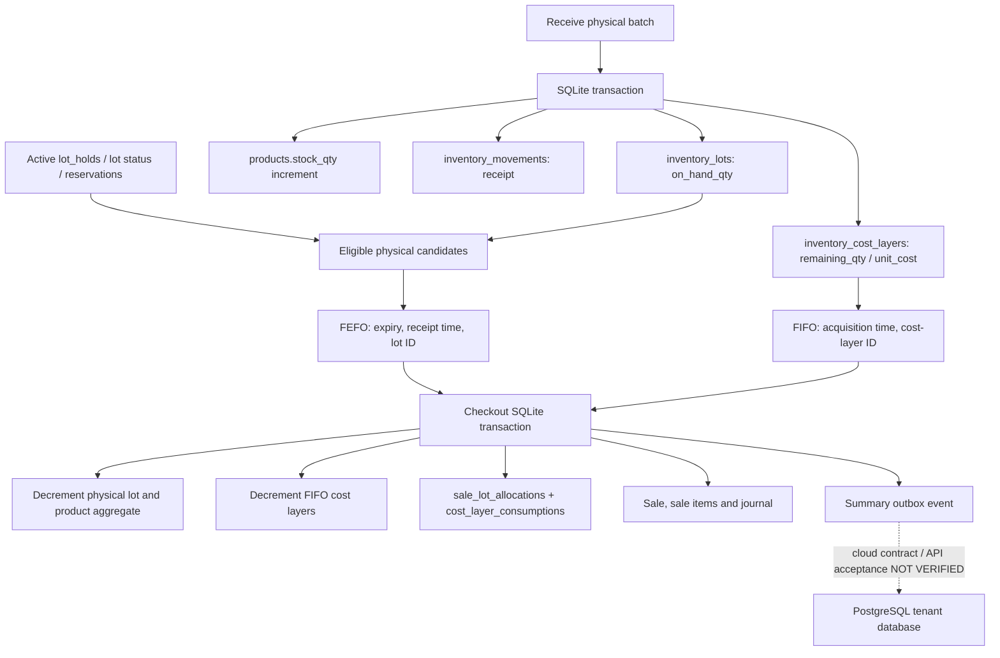

# Prompt 09 — Inventory FEFO/FIFO Audit

**Date:** 2026-10-20 (Asia/Jakarta)  
**Repository:** `berkah-pos/Berkahtigaputeri`  
**Audit branch:** `audit/prompt-09-inventory-fefo-fifo-2026-10-20`  
**Base revision:** `371b7fdf0bf672b37ceb1023e647f114221bf797`  
**Scope:** Inventory lot receiving, expiry/minimum-shelf-life eligibility, physical FEFO allocation, financial FIFO cost-layer consumption, reservations, stock/movement consistency, legacy stock reconciliation and the current PostgreSQL counterpart.  
**Disposition:** **PARTIAL — source contracts are inspectable, but inventory/cloud parity and several lifecycle acceptance gates remain NOT VERIFIED.**  
**Change boundary:** This report is the only intended repository change for Prompt 09. No application code, algorithm, schema, workflow, dependency, secret, live data, deployment or production resource was changed.

## 1. Executive result

The local Flutter inventory implementation has a coherent separation of two rules:

- **Physical stock** is allocated by FEFO (earliest eligible expiry, then receipt time, then stable lot ID) when expiry is tracked; products that do not track expiry use receipt-time/ID ordering.
- **Financial COGS** is consumed independently from FIFO cost layers ordered by acquisition timestamp then stable layer ID.
- Checkout, physical lot changes, cost-layer consumption, product aggregate stock, sale/line records, accounting journal and outbox insert are inside one SQLite transaction. Conditional updates and schema checks provide useful fail-closed guards.
- Existing source tests cover FEFO tie-breaking, non-expiry fallback, an active hold, minimum shelf life, required expiry receipt metadata, migration and an example proving physical FEFO can select one lot while FIFO values COGS from an older receipt layer.

That is positive **SOURCE-VERIFIED** evidence, not a test pass. None of those Flutter tests was executed during this audit. For the queried revision, the connected GitHub calls returned no combined-status rows and no workflow runs; that result does not establish a pass or a failure.

The most important release blocker is the current **SQLite-to-PostgreSQL contract mismatch**. The SQLite schema contains separate physical lots, reservations, holds, cost layers, sale-lot allocations and cost-layer consumptions, with integer quantities and integer Rupiah costs. The PostgreSQL tenant starter migration has a simpler lot table with decimal quantities/costs, different field names, and no matching reservation/hold/cost-layer-consumption schema. The local outbox payload inspected here contains only sale summary fields. There is no verified cloud inventory acceptance path for FEFO, FIFO, lot traceability, reservations or exact money/quantity conversion.

## 2. Evidence protocol and authoritative documents

Evidence labels used below:

- **SOURCE-VERIFIED:** the named repository source was fetched and inspected at the audit revision.
- **TEST SOURCE PRESENT:** a test file and assertions exist; the test has not necessarily run.
- **CI-OBSERVED:** only an observed workflow/status result tied to its exact revision.
- **NOT RUN / NOT VERIFIED:** no execution or runtime evidence is available for the claim.

The required authority sequence was read: root `AGENTS.md`; `DOC_00_CANONICAL_ARCHITECTURE_DECISION.md`; the 2026-10-17 owner ADR; the 2026-10-16 ADR; `DOC_14_KVM2_ISOLATED_TENANT_ARCHITECTURE.md`; `DOC_00_MASTER_ROADMAP.md`; permanent-document `README.md`; DOC_12; DOC_13; legacy-named `DOC_01_3_LAYER_CONFIG.md); `.cursor/rules/berkah-pos.mdc`; and `.github/muse-instructions.md`.

The current owner decision is Hostinger KVM2 + Coolify, Laravel/PHP 8.4 and private PostgreSQL 17, with separate tenant databases and **no Supabase product use or access**. Historical Supabase files are not an approved runtime or inventory source. The roadmap and DOC_14 explicitly require actual PostgreSQL grants, API parity and real execution evidence before acceptance. Nothing in this report attempts a hosted-project connection.

## 3. Source map and data-flow graph

### 3.1 Inspected nodes

| Node | Evidence | What the source establishes |
|---|---|---|
| SQLite database and constraints | `pos-app/lib/core/database/pos_database.dart:19, 241–254, 273–329, 332–397, 465–480` | Schema v3; physical lots; lot holds; reservation header/lines; distinct cost layers; physical allocation and financial-consumption audit rows; stock movement table; non-negative quantity/cost checks; reserved quantity cannot exceed on-hand quantity. |
| Lot value object | `pos-app/lib/features/inventory/models/inventory_lot.dart` | Lot carries batch, expiry date, first receipt time, on-hand/reserved quantity and operational status; available quantity is on-hand minus reserved. |
| FEFO policy | `pos-app/lib/features/inventory/services/fefo_engine.dart:54–125` | Rejects nonpositive requested quantity/negative shelf-life setting; uses a date-only business date; applies expiry/minimum shelf life when tracking expiry; deterministically sorts and fails closed when eligible stock is insufficient. |
| FIFO valuation policy | `pos-app/lib/features/inventory/services/fifo_cost_engine.dart:54–112` | Separately orders remaining cost layers by acquisition time then layer ID; rejects nonpositive requests and insufficient cost-layer quantity; calculates integer total cost as quantity × unit cost. |
| Physical inventory controls | `pos-app/lib/features/inventory/repositories/sqlite_inventory_repository.dart:27–120` | Creates/release holds, changes operational status and marks lots expired. Holds are consulted by reservation/checkout eligibility. |
| Receiving, product aggregate and legacy reconciliation | `pos-app/lib/features/products/repositories/sqlite_product_repository.dart:34–110, 114–207, 212–296, 358–404` | Product edits do not overwrite ledger-owned stock; receipts write physical lot, FIFO layer, aggregate stock and receipt movement transactionally; legacy reconciliation requires product stock to equal summed lot on-hand quantity before the archive row is marked reviewed. |
| Reservation lifecycle | `pos-app/lib/features/inventory/repositories/sqlite_reservation_repository.dart:63–267, 286–385` | Creates a fingerprinted reservation inside a SQLite transaction, excludes held/non-saleable lots, increments reserved quantity conditionally, and releases quantity for release/expiry. |
| Sale/checkout orchestration boundary | `pos-app/lib/features/pos/checkout/sqlite_sale_repository.dart:31–343, 345–463, 465–604, 606–680` | Uses FEFO for physical lot allocation and FIFO for cost layers; updates stock/lots/layers and writes sales, allocations, consumptions, journal and outbox within the database transaction. |
| PostgreSQL tenant starter migration | `database/migrations/tenant/2026_10_17_000001_create_tenant_pos_tables.php:35–43, 48–86, 103–112` | Creates a starter lot/sale/sale-item/movement/receipt schema; it is not equivalent to the richer SQLite inventory model. |
| Existing local behavior tests | `pos-app/test/inventory/fefo_engine_test.dart`; `fefo_checkout_test.dart`; `reservation_test.dart`; `database_migration_test.dart`; `../products/sqlite_product_repository_test.dart` | Test source exists for selected happy-path and negative cases, but this audit did not execute it. |

### 3.2 End-to-end local data flow

The transaction helper uses `database.transaction(..., exclusive: true)` in `pos_database.dart:48–51`. A sale-level duplicate transaction ID is checked against a request fingerprint in `sqlite_sale_repository.dart:35–67`. Reservation allocation uses a conditional `reserved_qty = reserved_qty + ?` update at `sqlite_reservation_repository.dart:213–227`, and checkout conditionally decrements stock/lot/layer quantities. These are protective source patterns; real race/rollback behavior still needs execution evidence.

### 3.3 FEFO and FIFO are intentionally different

For one product with two units:

| Receipt layer / lot | Received | Expiry | Quantity | Unit cost |
|---|---|---|---:|---:|
| `LOT-LATE-EXPIRY` | 2026-08-01 | 2027-01-31 | 1 | Rp30,000 |
| `LOT-EARLY-EXPIRY` | 2026-09-01 | 2026-10-15 | 1 | Rp40,000 |

For a sale of one unit on 2026-09-30, with expiry tracking enabled and minimum shelf life 0 days:

1. FEFO dispenses `LOT-EARLY-EXPIRY`, because 2026-10-15 is the earlier eligible expiry.
2. FIFO consumes the oldest financial layer, `cost:LOT-LATE-EXPIRY`, giving COGS of Rp30,000.
3. The physical `LOT-EARLY-EXPIRY` quantity becomes 0; `LOT-LATE-EXPIRY` physical quantity remains 1. The older cost layer has remaining quantity 0; the later cost layer remains at 1.

This exact separation is asserted by `fefo_checkout_test.dart:15–88`. It is the intended product contract documented in `pos-app/docs/APOTEK_INVENTORY.md`, not in itself evidence of a defect. It does mean reconciliation must not incorrectly require the remaining quantity of each cost layer to equal the physical quantity of its linked lot. The implementation needs product-level quantity reconciliation plus clear, durable traceability for the separate physical and cost allocations.

## 4. Findings

### INV09-01 — PostgreSQL inventory schema and outbox do not yet preserve the local contract

**Severity:** P1 — release blocker for cloud inventory parity  
**Confidence:** High  
**Evidence status:** SOURCE-VERIFIED; cloud behavior NOT VERIFIED

**Evidence**

- SQLite physical lot fields and constraints: `pos-app/lib/core/database/pos_database.dart:241–254`.
- SQLite reservations/holds: same file `273–329`.
- SQLite FIFO layers, inventory movement, physical allocations and cost-layer consumptions: same file `332–397`.
- SQLite stock costing movement: same file `465–480`.
- PostgreSQL starter lots: `database/migrations/tenant/2026_10_17_000001_create_tenant_pos_tables.php:35–43` uses `batch_code`, `expires_at`, `quantity_received DECIMAL(18,3)`, `quantity_remaining DECIMAL(18,3)`, `unit_cost DECIMAL(18,2)` and `received_at`. It has no corresponding lot status, reserved quantity, active holds, reservation rows, distinct FIFO cost-layer table, `sale_lot_allocations`, or `cost_layer_consumptions`.
- The local checkout outbox payload at `pos-app/lib/features/pos/checkout/sqlite_sale_repository.dart:306–324` contains sale ID, transaction ID, business date, grand total, PPN amount and payment method. The payload does not include the sale lines, per-lot physical allocations, cost-layer consumptions or the corresponding movement details.

**Risk / failure scenario**

The backend starter schema cannot currently represent the detailed local inventory lifecycle as the same contract without additional approved mapping/design. SQLite uses integer quantities and integer Rupiah costs; the PostgreSQL starter allows fractional quantities and decimal costs. There is no verified rule for unit scale, conversion, or rounding between them. Different field names alone are manageable, but the missing concepts and precision differences mean the current schema/payload cannot be assumed to preserve FEFO allocation, FIFO valuation, lot traceability, reservation status or exact quantity totals during sync.

**Required acceptance**

On a disposable PostgreSQL 17 target, after a reviewed mapping/API is implemented:

1. Receive two dated lots and two FIFO cost layers for one product.
2. Execute a checkout that intentionally selects one physical lot by FEFO and one cost layer by FIFO.
3. Assert server-side accepted sale, sale items, physical lot balances, inventory movements, cost-layer balances/consumptions, COGS and idempotency receipt commit atomically.
4. Replay the identical event and prove no second decrement or accounting post; submit the same event ID with different canonical content and prove conflict rejection.
5. Prove exact SQLite-to-PostgreSQL quantity, unit, cost and Rupiah conversion including zero, maximum supported quantity/cost, and any permitted fractional unit case. No implicit rounding may alter a sale.
6. Confirm the cloud event includes sufficient canonical line data or a verified server retrieval contract; a summary-only event must not be treated as a complete inventory sync payload.

**Handoff:** Laravel API / PostgreSQL inventory-schema owner and Flutter sync owner. Prompt 09 does not implement the mapping.

### INV09-02 — Return, void, reversal and stock-adjustment flows are missing from the audited inventory nodes

**Severity:** P1 — operational/accounting completeness gate  
**Confidence:** High for the assigned paths; repository-wide absence not certified  
**Evidence status:** SOURCE-VERIFIED / MISSING in the reviewed node paths

**Evidence**

- The inspected `SqliteProductRepository` receives batches and adjusts aggregate stock only through the matching ledger operation (`sqlite_product_repository.dart:114–296`).
- `SqliteInventoryRepository` exposes holds, release, lot-status changes and expiry marking (`sqlite_inventory_repository.dart:27–120`), but no quantity-adjustment/return method is present in this repository.
- `SqliteSaleRepository.processPayment` creates a sale and consumes lot and FIFO quantities (`sqlite_sale_repository.dart:31–343`); no return/void/reversal entry point was present in the inspected checkout file.
- Existing movement types shown by these paths include receipt, opening-balance migration and sale. No tested, compensating inventory path was found in the assigned node set.

**Risk / failure scenario**

A legitimate customer return, void after stock has been decremented, damaged-goods write-off, correction of a receiving error or physical-count adjustment cannot be presumed to restore/reclassify on-hand quantity and the corresponding cost layers/movements correctly exactly once. Directly editing counts would bypass the event trace and could leave product aggregate stock, lots, cost layers and journals inconsistent. The inventory documentation also says operational hold/status changes must not invent journal postings and that disposal/write-off needs an explicitly approved COA mapping.

**Required acceptance**

Add/review a separate compensating-event contract (outside this prompt’s implementation scope) that is idempotent and atomic. Tests must cover full and partial returns, repeat return/void events, attempts to reverse a nonexistent/already reversed sale, damaged/expired stock write-off, positive and negative physical counts, and failure after each intermediate write. Verify original sale/journal history remains auditable; inventory correction creates traceable movements rather than silently mutating posted history; approved journal mapping preserves accounting policy.

**Handoff:** Accounting/journal owner plus checkout/returns owner; server sync owner for matching idempotent cloud events.

### INV09-03 — A dated lot can bypass its known expiry when product-level expiry tracking is disabled

**Severity:** P2 — expiry-policy ambiguity with possible sale eligibility inconsistency  
**Confidence:** High on the observed code path  
**Evidence status:** SOURCE-VERIFIED; no runtime reproduction executed

**Evidence**

- `sqlite_product_repository.dart:144–159` requires batch and expiry only when `product.trackExpiry` is true, but still stores an `expiryDate` supplied when tracking is false.
- `fefo_engine.dart:74–87` immediately accepts a positive-quantity candidate when `trackExpiry == false`, without checking its `expiryDate`.
- `sqlite_inventory_repository.dart:108–119` marks dated lots expired only when the expiry date is earlier than the business date and the status is still saleable.
- `sqlite_sale_repository.dart:345–400` excludes non-saleable statuses before invoking FEFO, but the FEFO engine skips date validation for non-tracked products.

**Risk / failure scenario**

For a non-tracked product with an expiry date recorded as yesterday, a lot can remain `saleable` and be considered by the receipt-time fallback until `markExpiredLots` runs. After that status job, it is excluded. Thus eligibility depends on whether that status update has run, even though an expiry date is already present. The intended contract may instead be that a non-tracked item must not carry an expiry date, or that a known date is always authoritative. Current source does not enforce either policy.

**Required acceptance**

The owner must choose one explicit rule: (a) reject `expiryDate` for non-expiry-tracked products at receipt, or (b) always enforce a provided expiry date during checkout even when tracking is off. Add tests for a past expiry, the expiry day itself, next day, no expiry date, minimum shelf life 0 and greater than 0, and before/after the expiry-marking job. The same fixture must produce the same sale decision regardless of whether a maintenance job has run.

**Handoff:** Inventory policy owner; no algorithm change made.

### INV09-04 — Reservation replay returns the existing terminal reservation without requiring an active state

**Severity:** P2 — idempotency/status contract needs clarification  
**Confidence:** High on the return path; caller impact depends on API contract  
**Evidence status:** SOURCE-VERIFIED; no retry test executed

**Evidence**

- `sqlite_reservation_repository.dart:104–124` searches by unique `transaction_id`; if the stored fingerprint matches, it returns `_loadReservation(...)` without requiring `status == active`.
- The reservation schema permits `active`, `committed`, `released` and `expired` (`pos_database.dart:291–304`).
- The existing reservation tests cover creating/consuming a reservation and releasing an expired one (`reservation_test.dart:14–175`), but no test was found for repeating `reserve` after the existing reservation is terminal.

**Risk / failure scenario**

A retry using the same transaction ID and fingerprint after reservation release, expiry or checkout commit returns an existing record with that terminal state; it does not create a new active reservation. This may be correct idempotency, but a caller that interprets a successful method return as a newly active lock could proceed under a false assumption. The contract needs to make status—not method completion—the result that controls subsequent checkout.

**Required acceptance**

For the same transaction ID and payload, retry in each state (active, committed, released, expired); assert the precise return/error contract, prove no duplicate reservation lines or double increment of `reserved_qty`, and require checkout to reject terminal reservations. A different payload with the same transaction ID must continue to fail as a conflict.

**Handoff:** Inventory reservations owner and checkout API/UI caller owner.

### INV09-05 — Lot status/hold transitions do not reconcile existing reservation locks; receiving into a non-saleable lot is not prohibited

**Severity:** P2 — inventory lifecycle consistency risk  
**Confidence:** High on missing guards; impact needs policy acceptance  
**Evidence status:** SOURCE-VERIFIED

**Evidence**

- `sqlite_inventory_repository.dart:27–70` creates an active hold; `91–101` changes lot status directly.
- `sqlite_reservation_repository.dart:158–176, 213–227` creates reservations only from saleable, unheld lots. `sqlite_sale_repository.dart:465–604` rechecks a reserved lot and rejects a status/hold/expiry violation during checkout.
- `sqlite_product_repository.dart:212–296` checks that an existing lot exists before adding a new cost layer and increasing lot/product quantities, but the inspected method does not reject a lot whose status is quarantine, damaged, expired or recall, and does not test for an active hold.
- `sqlite_sale_repository.dart:606–624` supplies FIFO with every positive remaining cost layer for the product; it does not filter by the referenced physical lot’s status or active hold. That separation may be deliberate for aggregate FIFO valuation, so the audit does **not** assume that a non-saleable layer must automatically be removed from financial valuation.

**Risk / failure scenario**

If a lot has active reservations and is then held or marked recall/quarantine, checkout correctly rejects dispensing it, but the reserved quantity is not released by the status/hold method. That can leave stock unavailable to new reservations until explicit release or expiry. Separately, receiving into a held/non-saleable physical lot increases its stock and adds FIFO cost while its physical lot remains ineligible for sale. The accounting treatment of that quantity is not defined by these methods. The distinction between physical allocation and cost layers makes an explicit policy important; do not “fix” it by simply sharing FEFO and FIFO ordering.

**Required acceptance**

Test reserve → hold and reserve → status change to recall/quarantine; assert whether reservation is atomically invalidated/released or explicitly retained and visible as blocked, without permitting checkout or negative availability. Test receipt into each non-saleable status and with an active hold; either reject it or define a quarantine-receiving workflow. Clarify whether held/expired layers remain part of aggregate FIFO valuation until a separate write-off event, then test the selected accounting contract.

**Handoff:** Inventory operations owner and accounting valuation owner.

### INV09-06 — Inventory unit/scale and exact cloud precision are not aligned by a verified contract

**Severity:** P2 — financial/data conversion acceptance gate (linked to INV09-01)  
**Confidence:** High that source representations differ; intended unit policy is not documented here  
**Evidence status:** SOURCE-VERIFIED; conversion NOT VERIFIED

**Evidence**

- SQLite quantity fields are integers, including `products.stock_qty`, `inventory_lots.on_hand_qty/reserved_qty`, `inventory_cost_layers.remaining_qty`, movement and allocation quantities (`pos_database.dart:241–254, 332–397, 465–480`).
- SQLite `unit_cost`, `total_cost` and sale financial amounts are integer-valued; the FIFO result uses integer multiplication (`fifo_cost_engine.dart:26–28`).
- The PostgreSQL tenant migration uses `DECIMAL(18,3)` for lot quantity and movement/sale-item quantity and `DECIMAL(18,2)` for unit cost and sale monetary fields (`2026_10_17_000001_create_tenant_pos_tables.php:35–43, 62–86`).
- No UOM/scale/conversion field or conversion policy appears in the inspected SQLite lot/cost-layer contract.

**Risk / failure scenario**

If the intended product is whole-piece inventory, PostgreSQL can represent values the client cannot represent. If weight/fractional unit sales are intended, the SQLite integer quantity model cannot express the contract without a defined scaled-integer unit or conversion mechanism. Decimal monetary columns also cannot be assumed equivalent to integer Rupiah without an explicit encoding/rounding contract.

**Required acceptance**

An owner must approve the supported units (e.g. whole item only, or defined milli-unit scale), maximum quantities and cost bounds, integer Rupiah representation, serialization schema and reject/rounding policy. Execute round-trip tests for receipt → reservation → sale → return/adjustment → sync, proving no precision loss and equality of integer totals; reject unsupported fractional input instead of silently truncating.

**Handoff:** Product/business owner plus Flutter/PostgreSQL data-contract owner.

## 5. Positive controls confirmed by source (not runtime passes)

1. **Deterministic FEFO:** expiry date, first receipt time and stable ID tie-breakers are explicitly implemented in `fefo_engine.dart:88–102`. The policy normalizes the business date and enforces `expiry >= businessDate + minimumShelfLifeDays` when expiry tracking is active (`70–87`).
2. **Non-expiry fallback:** the engine filters positive available quantities, then orders by receipt time and ID if expiry tracking is disabled (`fefo_engine.dart:74–105`).
3. **Fail-closed shortage:** FEFO totals eligible units before allocating and throws on shortage (`fefo_engine.dart:106–115`); FIFO does the same for cost layers (`fifo_cost_engine.dart:63–86`).
4. **Concurrent-write guards in source:** reservation uses a conditional reserved-quantity update; checkout uses conditional lot, layer and product updates. SQLite operations are enclosed in transactions.
5. **Receiving transaction:** `addInventoryLot` adds a physical lot, FIFO cost layer, aggregate stock and receipt movement in one transaction (`sqlite_product_repository.dart:114–207`). The existing-lot receipt similarly inserts layer, increases lot/product quantity and adds a receipt movement inside a transaction (`212–296`).
6. **Legacy physical reconciliation:** `markLegacyStockReconciled` compares product aggregate stock with summed physical lot on-hand values before marking the archival row reviewed (`sqlite_product_repository.dart:358–404`). The V1 migration tests a simple row converting to both a physical lot and FIFO layer (`database_migration_test.dart:11–120`). This is not a proof that all real legacy data is reconciled.
7. **COA constants:** sale journal source debits COGS and credits Inventory using the locked `CoaAccounts.cogs` and `CoaAccounts.inventory` entries (`sqlite_sale_repository.dart:755–770`). The inventory contract documents Dr `5-5010` COGS / Cr `1-1040` Inventory. This confirms source use of the named constants, not independently executed journal balance/COA tests.
8. **Failure rollback:** the transaction encloses all local checkout writes; the shelf-life test source asserts a rejected sale leaves lot quantity unchanged and creates no sale (`fefo_checkout_test.dart:147–187`). The test itself has not been executed in this audit.

## 6. Required test matrix and execution state

All tests below are proposed acceptance tests unless explicitly marked “test source present”. No test listed here was executed during this audit.

| Test | Minimum assertion | Current evidence/status |
|---|---|---|
| FEFO ordering & tie-breakers | Expiry ASC, received-at ASC, lot ID ASC; stable results for shuffled candidate inputs | Test source present: `fefo_engine_test.dart:8–44`; execution NOT RUN |
| Non-expiry ordering | When the selected policy is no expiry tracking, receipt timestamp then ID determines physical allocation | Test source present: `fefo_engine_test.dart:46–71`; execution NOT RUN |
| Expiry boundaries | Past date, expiry today, minimum shelf life 0 and positive, missing expiry; same result before/after expiry marking | Partial source test present: `fefo_checkout_test.dart:147–187`; full edge matrix NOT VERIFIED |
| Holds/status | Active hold, released hold, quarantine, damaged, expired and recall all block physical allocation; status updates cannot silently strand reservations | Active hold test source present: `fefo_checkout_test.dart:90–145`; transition matrix NOT RUN |
| FIFO unit behavior | Acquisition ASC then cost-layer ID; multiple-layer split; exact COGS; insufficient layer data; zero-quantity request; zero-cost layer; high bounds | No dedicated `fifo_cost_engine_test.dart` was found at the expected path; integrated FIFO assertions exist in `fefo_checkout_test.dart:15–88`. Execution NOT RUN |
| Reservation idempotency | Same payload replays without second increment; changed payload conflicts; committed/released/expired retry returns documented state; checkout rejects terminal reservation | Source tests cover reservation checkout and expiry release (`reservation_test.dart:14–175`); replay/terminal/concurrency cases NOT VERIFIED |
| Race for last unit | Two concurrent reservations competing for one available unit yield exactly one active reservation; `reserved_qty <= on_hand_qty`; rollback of loser is complete | NOT RUN; no concurrent test evidence found in scoped tests |
| Atomic receipt | Duplicate lot/layer IDs or failure between writes rolls back lot, cost layer, product aggregate and movement together | Transactional code present; fault-injection/duplicate receipt tests NOT VERIFIED |
| Aggregate stock invariant | After every receive, sale, reservation, release, migration and reconciliation: product stock equals sum of lot on-hand quantities; reserved remains within on-hand; aggregate cost-layer units remain consistent with the selected FIFO policy | Partial individual assertions exist; complete invariant/property suite NOT VERIFIED |
| Migration + legacy reconciliation | Upgrade each supported SQLite schema; source remains preserved; imported archive totals/counts are repeatable; mismatched product-vs-lot counts block reconciliation | V1 happy-path test source present; broad fixtures/negative reconciliation NOT RUN |
| Returns/write-offs/adjustments | Exactly-once compensating movements; physical lot and cost-layer effects are defined; journal remains balanced and original post is not silently rewritten | MISSING from audited node paths; implementation/acceptance NOT VERIFIED |
| PostgreSQL parity / sync replay | Same FEFO/FIFO traces, unit/precision contract, accepted receipt idempotency and no duplicate stock/journal effect on replay | Starter migration only; API end-to-end inventory test NOT RUN / NOT VERIFIED |

### Execution and CI record

- **TEST-EXECUTED:** None by this audit. The environment did not contain a checkout of the repository or Flutter/Dart executables. No source test is described as passed.
- **CI-OBSERVED:** The connected GitHub query for combined statuses on `371b7fdf0bf672b37ceb1023e647f114221bf797` returned an empty status list, and the workflow-run query returned no runs. This is **no current-head CI evidence retrieved here**, not a pass/fail assertion about every GitHub check.
- **Prior baseline:** repository documentation records a limited PHP/Laravel/PostgreSQL scaffold smoke run on the earlier SHA `aab154f87342f2a02a1319e1d370ce831dbef522`. That old, limited pass does not execute or certify the Flutter FEFO/FIFO suite or current inventory-to-API parity.
- **STAGING-OBSERVED / PRODUCTION-OBSERVED:** None for the assigned inventory flows.

## 7. Acceptance gate and next actions

**Prompt 09 status: PARTIAL / NOT VERIFIED.** The local source has meaningful FEFO/FIFO controls and test cases, but the required test execution, concurrent-reservation proof, return/adjustment path, explicit unit/precision contract and PostgreSQL inventory parity are missing.

Order of work for the owning teams, without expanding this audit into implementation:

1. **API/database contract owner:** specify how physical lots, holds, reservations, movement events, FIFO cost layers, cost-layer consumptions and allocation traces map into PostgreSQL 17, including scale/rounding and idempotency.
2. **Inventory owner:** approve the expiry rule for a known expiry date on non-tracked products; specify hold/status transition behavior for active reservations and receiving into non-saleable lots.
3. **Accounting/checkout owner:** define returns, voids, write-offs and stock adjustments as audited compensating events without mutating posted sale/journal history; explicitly preserve COA `1-1040` Inventory and `5-5010` COGS.
4. **QA owner:** execute the applicable matrix on an isolated build, capture exact command, Flutter/Dart version, tested SHA, output/exit status and artifacts; add the concurrency, negative, retry and fault-injection cases before claiming acceptance.
5. **Independent reviewer:** re-audit the resulting API/schema/client contract and evidence; a green Flutter test alone cannot certify the PostgreSQL/cloud path.

No algorithm change, schema change, inventory adjustment, release decision or production action was performed as part of Prompt 09.
