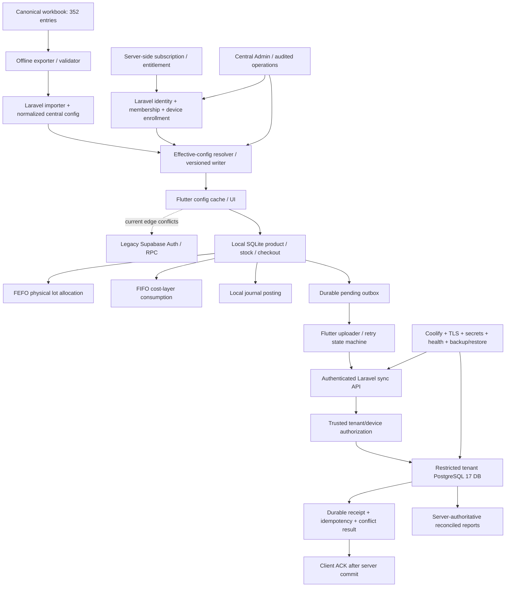

# Prompt 18 — Final Node Connection & Release Gate

**Audit date:** 2026-10-21 (Asia/Jakarta)  
**Repository:** [`berkah-pos/Berkahtigaputeri`](https://github.com/berkah-pos/Berkahtigaputeri)  
**Reviewed application baseline:** `main` at `371b7fdf0bf672b37ceb1023e647f114221bf797`  
**Purpose:** Final independent reconciliation of specialist reports, current-main source, exact-HEAD CI observations, release gates, and missing runtime proof.  
**Scope boundary:** Audit and documentation only. No application, test, migration, workflow, dependency, database, secret, infrastructure, staging, or production changes were made. No hosted database or Supabase project was accessed. The prohibited legacy workbook-to-Supabase script was not run.  
**Decision:** **NO-GO — release-critical connection edges are missing, conflicting with the owner ADR, or not verified.**

## 1. Executive decision

Berkah POS has a useful **local-first POS foundation** and a selected target architecture, but the integrated cloud SaaS cannot be accepted on the evidence reviewed. Local source traces connect product/inventory operations to a SQLite checkout transaction that writes a sale, sale items, inventory/cost effects, journal data, and a pending outbox event. That proves a source-level local path exists; it does **not** prove that it passes tests on the reviewed revision, that data reaches PostgreSQL, or that a server has accepted and durably acknowledged it.

The highest-impact release gaps are:

1. **No approved, connected Laravel mobile trust/API chain on current `main`.** The tracked Flutter client still declares/initializes `supabase_flutter` and calls the legacy effective-config RPC, contrary to the controlling 2026-10-17 owner ADR. On `main`, the inspected `routes/api.php` only exposes the platform-health response; no authenticated Laravel login/device enrollment, effective-config, entitlement, sync/receipt, conflict, or accepted-cloud-report endpoint was found in the inspected source tree.
2. **PostgreSQL tenant isolation is not proven.** The target calls for one private PostgreSQL 17 service, one central database, and a separate tenant database plus restricted runtime role per tenant. The source exposes a fail-open tenant credential fallback to central/global credentials. The broker, actual restricted roles/grants, tenant A/B denial, central DB denial, and worker-context reset have not been proven with real PostgreSQL identities.
3. **The local outbox stops before the server acceptance boundary.** No uploader/dispatcher or `POST /api/v1/sync` handler was found on `main`; the local payload is a summary rather than a complete immutable posting package. Durable server idempotency/receipts, payload-mismatch conflicts, ACK-after-commit, bounded retry and conflict UX are therefore missing or unverified.
4. **The workbook/configuration chain is incomplete and the active validation workflow conflicts with owner policy.** The current importer references central model classes not present at the expected tracked paths; no active resolver/versioned writer/effective-config API was found. Row-level manifest validation, deterministic SHA-256 repeatability, full atomic import, service-enabled semantics, and compare-and-swap (CAS) are not accepted. The current workbook workflow references the prohibited `scripts/sync_excel_to_supabase.py` even with `--dry-run`; that script must not be executed.
5. **Current-candidate release evidence is insufficient.** The reviewed `main` SHA has only two Dependabot check runs reported, both successful; the combined status endpoint returns no status contexts. No qualifying current-head Flutter, Laravel/PostgreSQL, workbook, or AAB workflow result was found. Staging/production, TLS, real grant tests, backup restore, measured load, publisher-signing continuity, and Play acceptance are not verified.

The correct disposition is **NO-GO**, not “almost ready” and not “NOT DETERMINED”: direct source evidence already establishes material conflicts/missing edges. No assertion is made that a production incident or cross-tenant exploit occurred; production was not inspected.

## 2. Authority and evidence method

### 2.1 Controlling contract

The audit followed the repository's required instruction sequence and authority split:

- [`AGENTS.md`](https://github.com/berkah-pos/Berkahtigaputeri/blob/371b7fdf0bf672b37ceb1023e647f114221bf797/AGENTS.md) sets evidence, safety, and release rules.
- [`DOC_00_CANONICAL_ARCHITECTURE_DECISION.md`](https://github.com/berkah-pos/Berkahtigaputeri/blob/371b7fdf0bf672b37ceb1023e647f114221bf797/docs/permanent/DOC_00_CANONICAL_ARCHITECTURE_DECISION.md) is the sole authority for configuration behavior: `GLOBAL → TEMPLATE → TENANT → SERVICE → DEVICE`; exactly 352 entries (1 global, 3 templates, 100 tenants, 140 service entries, 108 devices); one requested service per result; POS and Akuntansi are never merged.
- [`ADR-2026-10-17-OWNER-KVM2-LARAVEL-POSTGRESQL-NO-SUPABASE.md`](https://github.com/berkah-pos/Berkahtigaputeri/blob/371b7fdf0bf672b37ceb1023e647f114221bf797/docs/permanent/ADR-2026-10-17-OWNER-KVM2-LARAVEL-POSTGRESQL-NO-SUPABASE.md) is the current owner decision: Hostinger KVM2/Coolify, PHP 8.4/Laravel 13/Filament 5/Sanctum, private PostgreSQL 17, central DB plus one separate DB/restricted runtime role per tenant, no Supabase product or project use (including read-only).
- [`DOC_14_KVM2_ISOLATED_TENANT_ARCHITECTURE.md`](https://github.com/berkah-pos/Berkahtigaputeri/blob/371b7fdf0bf672b37ceb1023e647f114221bf797/docs/permanent/DOC_14_KVM2_ISOLATED_TENANT_ARCHITECTURE.md) defines target isolation/API/operations acceptance gates, but explicitly does not certify implementation or deployment.
- [`DOC_00_MASTER_ROADMAP.md`](https://github.com/berkah-pos/Berkahtigaputeri/blob/371b7fdf0bf672b37ceb1023e647f114221bf797/docs/permanent/DOC_00_MASTER_ROADMAP.md) governs Phase 0–7 sequence.
- [`DOC_12`](https://github.com/berkah-pos/Berkahtigaputeri/blob/371b7fdf0bf672b37ceb1023e647f114221bf797/docs/permanent/DOC_12_SAAS_DATABASE_OFFLINE_ARCHITECTURE_AND_AGENT_PROTOCOL.md) owns compatible offline/outbox/accounting/evidence rules; [`DOC_13`](https://github.com/berkah-pos/Berkahtigaputeri/blob/371b7fdf0bf672b37ceb1023e647f114221bf797/docs/permanent/DOC_13_UNIFIED_POS_APP_INTEGRATION_REPORT.md) is a legacy integration snapshot, not a target architecture or release proof. The legacy [`DOC_01`](https://github.com/berkah-pos/Berkahtigaputeri/blob/371b7fdf0bf672b37ceb1023e647f114221bf797/docs/permanent/DOC_01_3_LAYER_CONFIG.md) filename does not reduce the active configuration contract to three layers.

### 2.2 Evidence classes used

| Class | Meaning in this report |
|---|---|
| **SOURCE-VERIFIED** | The path or behavior is present/absent in the checked-in `main` tree at `371b7fdf0bf672b37ceb1023e647f114221bf797`, or the GitHub metadata was directly retrieved. An absent path only establishes absence in the inspected tree. |
| **CI-OBSERVED** | A specific GitHub Actions run/check and its SHA/status was directly observed. |
| **TEST-SOURCE-ONLY** | Test source is present or a specialist says it is present, but no qualifying execution result was retrieved for the reviewed `main` SHA. |
| **CANDIDATE AUDIT REPORT** | A report on an open, unmerged specialist PR. Useful as source-review evidence, but not merged implementation or a runtime test. |
| **DOC-ASSERTED** | A target/runbook/past result is documented but does not by itself prove the current runtime. |
| **NOT RUN / NOT VERIFIED** | No adequate execution/runtime evidence was available. It is not a pass. |
| **MISSING / CONFLICTING** | A release-required edge was not found in the checked-in tree or the found path conflicts with the controlling owner contract. |

### 2.3 Exact revision, current CI and change boundary

- `main` resolves to `371b7fdf0bf672b37ceb1023e647f114221bf797` (commit message: `qa: add fail-closed acceptance matrix and exact-head CI evidence (#58)`). This audit does not treat unmerged PR heads as if their content were on `main`.
- The exact-SHA check-runs endpoint returned **two** checks, both `Dependabot` and both `success` (run IDs `39184121515` and `39186055413`). The combined status endpoint returned an empty status list. Neither Dependabot check is evidence for Flutter, API, PostgreSQL tenant grants, workbook import, Android release build, or staging acceptance on this SHA.
- Repository branch metadata reports `protected: false`, `protection.enabled: false`, and no required status-check contexts (`enforcement_level: off`). The branch-protection details endpoint itself was not accessible to this connector; no broader claim is made about organization rulesets beyond the returned branch metadata.
- Historical baseline run `39005405149` is documented as passing the initial Composer/Laravel boot/routes, disposable PostgreSQL 17 migration smoke, and production-image smoke on the **older** SHA `aab154f87342f2a02a1319e1d370ce831dbef522`. It remains useful baseline evidence, but it is not an end-to-end product pass on the reviewed SHA.
- Source-audit reports consulted from unmerged PR heads: [Prompt 00 #94](https://github.com/berkah-pos/Berkahtigaputeri/pull/94), [01 #95](https://github.com/berkah-pos/Berkahtigaputeri/pull/95), [02 #96](https://github.com/berkah-pos/Berkahtigaputeri/pull/96), [04 #97](https://github.com/berkah-pos/Berkahtigaputeri/pull/97), [05 #98](https://github.com/berkah-pos/Berkahtigaputeri/pull/98), [08 #99](https://github.com/berkah-pos/Berkahtigaputeri/pull/99), [09 #100](https://github.com/berkah-pos/Berkahtigaputeri/pull/100), [11 #101](https://github.com/berkah-pos/Berkahtigaputeri/pull/101), [13 #102](https://github.com/berkah-pos/Berkahtigaputeri/pull/102), [15 #103](https://github.com/berkah-pos/Berkahtigaputeri/pull/103), [16 #104](https://github.com/berkah-pos/Berkahtigaputeri/pull/104), and [17 #105](https://github.com/berkah-pos/Berkahtigaputeri/pull/105). They remain unmerged candidate reports; none substitutes for the required executed test evidence.
- No matching Prompt 03, 06, 07, 10, 12 or 14 specialist report/PR was found in the inspected current-main report tree and open-PR inventory. These reports are recorded **NOT PROVIDED / NOT VERIFIED** for reconciliation purposes; no conclusion about work outside the visible repository is implied. Current source and other reports still provide enough evidence to make the release decision.

## 3. Final system graph

**Interpretation:** Nodes shown in this target diagram are not all delivered. On the checked-in `main` SHA, the active source graph reaches local SQLite transaction effects and a pending outbox but stops before an approved Laravel identity/config/sync boundary and durable cloud receipt. The dotted Supabase client path is **SOURCE-VERIFIED legacy code and a platform-policy conflict**, not an approved edge. The remaining disconnected nodes are required target nodes, not claims of a running service.

## 4. Cross-node connection and contract matrix

This matrix is based on the current-main source and the unmerged specialists’ source audits. “Test evidence” means qualifying execution on the reviewed candidate SHA, not merely test-file presence.

| ID / edge | Required contract and failure behavior | Evidence on reviewed `main` | State / release gate | Primary owner |
|---|---|---|---|---|
| E01 Workbook → exporter/validator | Exact required sheets; 352 unique entries and 1/3/100/140/108 type counts; deterministic manifest bytes and SHA-256 on two repeat exports; dry-run performs no writes. Invalid sheets/keys/counts fail closed. | Exporter source exists. Specialist #01 reports a hard-coded keyset MD5 but no manifest SHA-256/repeat-export artifact; actual export was not run in that audit. Workflow source invokes the prohibited legacy Supabase writer. | **PARTIAL / NOT VERIFIED; CI CONFLICT** | Prompt 01; Prompt 15 for workflow |
| E02 Exporter → importer → normalized central configuration | Validate every record/key/relationship/service/template/device and config shape before writes; map service `enabled`; import idempotently; all writes have atomic/recoverable boundaries; no partial tenant config on failure. | `ImportCanonicalWorkbook.php` exists but references central models absent at their expected tracked paths; source audit reports incomplete row-level validation, separate central/device write segments and missing service-enabled persistence. Import not executed. | **MISSING / P1** | Prompt 01; Prompt 04 schema |
| E03 Importer → resolver/versioned writer | `EffectiveConfigResolver` and version writer resolve only the requested service, return deterministic version/hash, and use CAS; invalid version/tuple fails closed. | No tracked `app/Services/EffectiveConfigResolver.php`, `VersionedConfigWriter.php`, or connected effective-config route was found. | **MISSING / P1** | Prompt 01; Prompt 03 API |
| E04 Identity → membership → device trust | Laravel/Sanctum authenticates session/token; active user and tenant membership, device ownership/state and tenant state are server-verified; spoofed client IDs are not authorization; revocation/expiry fail closed. | `routes/api.php` only provides platform-health; no Laravel mobile login/session, membership or device-enrollment handler was found. Flutter still uses Supabase Auth paths. Central user/device registry schema is not the trust service. | **CONFLICTING + MISSING / P0** | Prompt 02; Prompt 03 |
| E05 Subscription → server-side entitlement | Subscription state and entitlements independently govern protected API operations; expiry/suspension is server enforced and must not delete data; webhook/renewal handling only after an approved provider choice. | Some central schema concepts exist, but there is no verified request authorization chain applying entitlements to config, sync or reports. Provider selection and live subscription behavior were not validated. | **NOT VERIFIED / P1** | Prompt 12; Prompt 02/03 |
| E06 Central config → Flutter effective-config client/cache | Authenticate and authorize tenant/device/service; resolve `GLOBAL → TEMPLATE → TENANT → SERVICE → DEVICE`; one service per result; include version/hash; offline cache only for a previously server-issued result for the exact tuple. | Flutter `config_service.dart` still invokes legacy Supabase `get_effective_config`; no replacement Laravel config route/resolver found. Specialist #01 flags broad fallback that may return cached config on a server refusal. | **CONFLICTING + MISSING / P0** | Prompt 01; Prompt 06; Prompt 03 |
| E07 Flutter → local product/catalogue persistence | Product CRUD persists through SQLite with predictable migrations and transaction/stock ownership; offline UX remains functional. | Product repository/SQLite source exists. Exact-main analysis, tests, fresh migration and upgrade/restart acceptance are not verified by the current exact-SHA CI evidence. | **SOURCE-PRESENT; TEST NOT VERIFIED** | Prompt 06 UI composition; Prompt 07 SQLite/migrations |
| E08 Stock receiving → physical lots + aggregate stock + FIFO layers + movement | One atomic receipt; valid lot/expiry/status; stock, lot quantity, movement, and FIFO cost units remain consistent; failure rolls back all effects. | Inventory source implements receipt/lot/cost-layer structures. Specialist #09 reports meaningful FEFO/FIFO test source, but tests were not run; duplicate/fault injection, aggregate invariants and migration reconciliation are not verified. | **PARTIAL / NOT VERIFIED** | Prompt 09; Prompt 07 |
| E09 Cart preview → checkout request → committed sale | Preview cannot silently differ from persisted commit values; operation ID must be stable and persisted before posting; active/reviewed products and zero-payable policy are explicit. | Checkout previews cached product data, repository re-reads DB values, and per-call ID is created anew. No durable intent/ID recovery across restart; active-product/free-sale policy and stale quote handling need acceptance. | **PARTIAL / P1** | Prompt 08; Prompt 07 |
| E10 Checkout → sale/lines/FEFO/FIFO/stock/journal/outbox (local) | Every related local effect and pending outbox commit within one SQLite transaction; rollback leaves no partial effects; same ID+payload replays once; ID with changed payload conflicts. | Source transaction boundary and ID/fingerprint checks exist. Tests for replay/conflict/early stock failure exist in source, but are not certified executed on the reviewed main SHA; late failure after earlier mutations is untested. | **SOURCE-WIRED; TEST NOT VERIFIED** | Prompt 08; Prompt 09; Prompt 10; Prompt 07 |
| E11 Local journal → accounting integrity | Preserve COA; every post is balanced; posted journals immutable; corrections use reversals; periods lock; audit event identifies actor/time/device/version. | Local `JournalService` has application-level COA and debit=credit checks; current starter PostgreSQL schema lacks evidenced DB/trusted-boundary balance enforcement, immutable posting/reversal linkage, period close/lock and `accounting_events` contract. No cloud posting edge exists. | **PARTIAL / P1** | Prompt 10; Prompt 04 |
| E12 Local outbox → uploader/dispatcher | Versioned complete immutable posting envelope, stable event/transaction key, payload fingerprint, bounded retry/backoff, network timeout and app/process restart recovery, explicit pending/in-flight/retry/attention/ACK states. | Pending outbox insert and local counts exist; no current sender/dispatcher/API client found in the inspected Flutter source tree. Current row payload is a summary, insufficient by itself to reproduce/reconcile all sale, lot, movement and journal effects. | **MISSING / P0** | Prompt 11; Prompt 07 |
| E13 Uploader → authenticated Laravel sync API → tenant DB | API validates identity, membership, device, subscription and payload. It atomically commits sale/lines/stock/journal/idempotency/receipt; identical replay returns same receipt; changed payload is conflict; ACK only after durable commit. | Only platform-health route observed in `routes/api.php`; no `POST /api/v1/sync` or transaction controller found. Starter `sync_receipts` schema alone does not implement acceptance. | **MISSING / P0** | Prompt 03; Prompt 11; Prompt 17 |
| E14 Trusted tenant selector → PostgreSQL restricted database role | Tenant DB name derived from trusted server mapping; separate DB/runtime role; central/other tenant denial; normal web/queue never hold provisioner or migrator secrets; safe idempotent provisioning and cleanup. | `config/database.php` can fall back tenant credentials to central/global credentials. Compose shares central credentials. No reviewed PostgreSQL broker or actual role/grant output; baseline migrations reportedly use bootstrap `postgres` identity. No tenant A/B negative tests executed. | **CONFLICTING + NOT VERIFIED / P0** | Prompt 05; Prompt 04; Prompt 16 |
| E15 PostgreSQL schema → invariants | FK ownership prevents orphan line/movement/journal rows; quantity and monetary bounds; precision/time-zone contract; journal and idempotency invariants enforced at trusted boundary/DB; upgrades safe. | Main holds a starter schema. Specialist #04 reports orphan rows permitted, key accounting controls absent, unsafe rollback behavior and model gaps. Actual PostgreSQL 17 current-head migration/constraint suite is not evidenced. | **PARTIAL / P1** | Prompt 04; Prompt 10; Prompt 09 |
| E16 Local reports → accounting-grade metrics | Active/archive separation, tenant/device scope, business-date periods, void/reversal treatment, explicit net/gross/PPN labels; reconcile header/items/journal/stock/outbox/server receipt. | Local-only labels and archive separation are positive source controls. Summary is lifetime/unfiltered and includes PPN in “Penjualan lokal”; no reversal-aware status or report-to-ledger reconciliation tests/cloud accepted-report source were found. | **LOCAL-ONLY / NOT RECONCILED / P1** | Prompt 13; Prompt 10; Prompt 11 |
| E17 Central Admin → privileged operations / host-domain routes | Explicit auth, central-only domain, role checks, audit trail, separation from tenant routes; hostile Host/X-Forwarded-Host/inactive domain and cache invalidation fail closed. | Central panel provider and super-admin predicate exist, but custom admin resources/pages are placeholders in the inspected tree; full routes, authorization and hostile-domain behavior are not executed/verified. | **PARTIAL / NOT VERIFIED** | Prompt 14; Prompt 02; Prompt 05 |
| E18 Source SHA → all required CI/release checks → immutable artifact | Exact nominated SHA completes blocking app/API/PG17/workbook/security/build checks; no skip/startup failure counted as pass; immutable image/AAB digest tied to run/SHA. | Exact `main` SHA has only two Dependabot success checks and empty combined status. Historical baseline passed on older SHA, not current. Unmerged specialist reports do not count as current main checks. Branch API reports protection disabled/no required check contexts. | **NOT VERIFIED / P1 release blocker** | Prompt 15; Prompt 17 |
| E19 Android candidate → publisher-signed AAB → accepted update | Compliant Supabase-free app and backend contract; verify merged manifest/package/version/SDK/permissions; upload-certificate SHA-256 matches accepted key; install/update path and Play declarations verified. | Source manifest permission allowlist is a source observation only. Prompt #15 report records that inspected AAB was debug-signed with publisher signing skipped; no current compliant publisher-signed artifact, certificate continuity, packaged manifest inspection or Play acceptance evidence was found. | **NO-GO / P1** | Prompt 15; Prompt 06 |
| E20 API/DB → deployment readiness / private network / TLS | Exact CI image deployed to isolated staging; DB-aware readiness distinct from liveness; secrets/environment separation, private ingress, host routing, TLS and rollback all exercised. | No direct Coolify staging/production evidence. Current health endpoints may return success without testing PostgreSQL/migration readiness. Production topology and SSL identity were not inspected. | **NOT VERIFIED / P1** | Prompt 16; Prompt 15 |
| E21 Data stores/files/secrets → backup, restore, disaster recovery | Encrypted off-host coverage for central DB, every tenant DB, required files and recovery keys; checksums/manifest; isolated central+two-tenant restore, PITR and single-tenant restore measured. | Runbook/planning docs exist; no dated successful restore artifact or verified file/key recovery evidence found. Backup and resource/capacity checks are not execution evidence. | **NOT VERIFIED / P1** | Prompt 16; Prompt 17 |
| E22 Runtime/worker → observability and recovery | Bounded worker/queue lifecycle, context reset after failure, redacted correlation/logs, actionable DB/queue/backup/disk/latency alerts, resource headroom and load results. | Queue defaults and supervisor topology are limited; worker/scheduler deployment, log redaction, alert firing, load/capacity evidence and tenant A/B worker-context test are missing/not verified. | **NOT VERIFIED / P2 with release prerequisites** | Prompt 16; Prompt 05 |

## 5. Reconciled findings register and accountable remediation boundary

Duplicate reports have been collapsed into single final findings. Each row keeps one **primary owner**; contributors must coordinate through that owner rather than open competing implementation paths. Severity reflects release impact. These are source/evidence gaps, not assertions of a live incident.

| Finding | Severity / confidence | Evidence and failure scenario | Business impact | Exact closure test/evidence | Primary owner / supporting specialists |
|---|---|---|---|---|---|
| F18-01 — Legacy Supabase path conflicts with owner decision and approved cloud API chain is absent | **P0 / High** | `pos-app/pubspec.yaml`, `pos-app/lib/main.dart`, and `pos-app/lib/core/config/config_service.dart` retain Supabase SDK/init/auth/RPC, while main lacks a connected Laravel auth/config API. A user cannot safely use a permitted production cloud path; deleting the SDK without a replacement would also break functionality. | Product violates the accepted platform boundary; login/config cannot be accepted as Laravel-backed SaaS. | On exact candidate SHA, source/dependency/build scans show no active Supabase SDK, env, URL, RPC, credentials or runtime workflow; full Flutter auth/config fixtures pass against the authenticated Laravel Central API with no fallback. Do not access Supabase at any time. | **Prompt 02 / identity + Prompt 03 / API**; Prompt 01 config, Prompt 06 client, Prompt 15 release |
| F18-02 — PostgreSQL tenant privilege boundary is not implemented/proven; credentials fail open | **P0 / High** | `config/database.php` allows tenant user/password fallback to central/global identity; local Compose shares central credentials. Broker/role/owner/grant proof is missing. A misconfigured tenant DB identity may use wider central privileges. This does not prove production has such grants or an exploitation occurred. | Cross-tenant or central-data access could invalidate tenant isolation and expose business/accounting records. | Disposable PG17 with actual tenant A/B DBs and roles: inspect `pg_roles`, DB owners, memberships, CONNECT/PUBLIC, schema/table/sequence/default privileges; prove A denied CONNECT/SELECT/INSERT/UPDATE/DELETE against B and central business DB; prove web/ordinary queue lacks CREATEDB/CREATEROLE/DDL/provisioning secrets; adversarial DB-name/tenant/device/Host spoof tests; A-then-B same-worker reset after exception. | **Prompt 05 / tenant isolation**; Prompt 04 schema, Prompt 16 infra, Prompt 02 identity, Prompt 14 admin |
| F18-03 — Outbox has no end-to-end sync/receipt/ACK boundary | **P0 / High** | Main contains local pending event but no sender and no sync route/handler; payload is only a summary. Failure after local commit never reaches a proven server receipt; a future naive retry could duplicate or misapply effects. | Local pending sales cannot be claimed as cloud accepted/reconciled; multi-device ledger and inventory are not authoritative. | On exact candidate SHA, authenticated synthetic sale sends to PG17 and atomically commits header, items, stock/FEFO/FIFO movements, journal, receipt/idempotency row; same key+same payload returns identical receipt; same key+different payload returns conflict; fault-injected rollback leaves no partial writes; ACK only after commit; timeout/restart/retry preserve local data and do not duplicate. | **Prompt 11 / sync protocol**; Prompt 03 API, Prompt 05 authorization, Prompt 08 checkout, Prompt 09 inventory, Prompt 10 accounting, Prompt 17 QA |
| F18-04 — Workbook/import/resolver chain is not fail-closed or deterministic | **P1 / High** | Importer references absent central model classes; row-level key/mapping/shape checks are incomplete; service-enabled semantics and writes/version CAS are not complete; resolver/writer/API absent; exporter lacks required SHA-256 repeatability artifact. | A changed/invalid workbook may be partially applied or resolve wrong configuration; POS and Akuntansi settings/parity cannot be trusted. | Offline-only export twice from the canonical workbook; compare SHA-256 and bytes; verify exact sheets, template IDs, 352 records/counts/unique scope keys; malformed/duplicate/missing/wrong service, tenant, device and mapping fixtures must fail before first write; import/apply/post-check is atomic/recoverable, service `enabled` persists, CAS rejects stale version, API/Flutter fixture JSON+hash match; resolve service separately. | **Prompt 01 / config**; Prompt 04 schema; Prompt 03 API; Prompt 06 client; Prompt 15 workflow |
| F18-05 — Tenant schema and accounting integrity constraints are incomplete | **P1 / High** | Starter migration lacks full FK/owner constraints and declared evidence for accounting event history, posted-journal immutability, reversal linkage, closed-period protection and DB/trusted-boundary double-entry. Migration rollback behavior also needs review/test. | Orphans, inventory mismatch, unbalanced or mutable posted journals, and unreconstructable audit history may survive application-layer errors. | Fresh PG17 migration and upgrade/downgrade/forward-recovery tests on exact SHA; every business child has correct FK/tenant ownership; quantity and monetary bounds; journal posts balanced; posted rows immutable except reversal; closed period blocks posting; `accounting_events` captures actor/time/device/app version; late failure rolls back entire business event. | **Prompt 04 / schema**; Prompt 10 accounting, Prompt 09 inventory, Prompt 08 checkout |
| F18-06 — Checkout replay/rollback and inventory lifecycle gates are unproven | **P1 / High** | Operation ID is generated per checkout invocation, so crash after commit but before UI result can create a new ID on retry; stale preview may differ from persisted commit values; existing rollback case is early validation, not injected late failure. Inventory audit also flags unresolved return/void/adjustment and some expiry/reservation transitions. | Cashier may see ambiguous duplicate sales; sale and on-hand/cost/journal state may diverge in untested edge cases. | On isolated fixture, persist the intent/key before posting; restart after commit before UI confirmation and retry exact key; same-key replay once, changed-input conflict; stale price/tax triggers reconfirmation/rejection; inject fault after first line/inventory and after journal before outbox and assert exact no-partial state; verify FEFO vs FIFO, reservations, holds, known expiry, return/void/reversal and aggregate stock invariants. | **Prompt 08 / checkout**; Prompt 07 local DB, Prompt 09 inventory, Prompt 10 accounting, Prompt 11 sync |
| F18-07 — Current-head CI and branch protection do not establish a release candidate | **P1 / High** | Exact main SHA currently shows only two Dependabot checks; combined statuses are empty. Branch metadata says protection disabled/no required status contexts. Historical scaffold CI and reports on open PR branches are different SHAs/scope. | A defective/unreviewed candidate can be treated as releaseable without required tests/traceable artifacts. | Run required checks on one immutable nominated commit; retain run/job IDs, actual completed job output, SHA, tool versions and artifact hashes; require Flutter analysis/tests, Laravel/PHP tests, fresh PG17 migrations and role grants, workbook validation, security scan and release build; branch protection must require these checks. Reject skipped/startup-failed jobs and evidence from other SHAs. | **Prompt 15 / CI-release**; Prompt 17 QA; repository maintainer/owner |
| F18-08 — Android publisher release evidence is not complete | **P1 / High** | Prompt #15 branch report records most recent inspected AAB as debug-signed and publisher-signing steps skipped; source manifest allowlist alone does not prove merged AAB manifest, key compatibility or Play acceptance. Privacy/Data Safety material contains stale Supabase claims per the report. | Update package/certificate incompatibility or Play compliance rejection could block or harm release; release claim cannot be supported. | After F18-01 is remediated, produce exact-SHA publisher-signed AAB; extract final manifest and assert package/version/SDK/permissions; compare upload certificate SHA-256 with owner-controlled accepted fingerprint; test install/update on device; reconcile privacy/Data Safety with actual data/network flows; record Play Console review and owner approval. | **Prompt 15 / release**; Prompt 06 mobile, Prompt 17 QA |
| F18-09 — Backup/restore, deployment readiness and capacity remain documentation-only | **P1 / High** | No staging/production topology/HTTPS/readiness observation, successful restore artifact, measured load or resource high-water evidence. Health endpoints may report OK without DB readiness. Local-only filesystem/file backup and worker/alerts are incomplete/not verified. | One host/DB/storage failure may be unrecoverable; app may appear healthy while cloud operations fail; unsupported capacity claims could oversell reliability. | Deploy immutable CI image to isolated staging; verify private PG17/network/TLS/host boundaries and DB/migration readiness; rehearse rollback; backup encrypted off-host central + two tenant DBs, files and recovery keys; restore checksums and referential/ledger invariants, PITR and single-tenant restore; measure recovery times; run representative load and alert/redaction/worker reset tests; document actual KVM2 headroom. | **Prompt 16 / infra-recovery**; Prompt 15 release, Prompt 04 schema, Prompt 05 security, Prompt 17 QA |
| F18-10 — Reporting is local summary, not accounting-grade or cloud-consolidated reconciliation | **P1 / High** for release claims; local-only totals source-verified | Report query is lifetime/unfiltered, “Penjualan lokal” includes PPN, status is not reversal-aware, and totals are not reconciled to sale lines, journal, inventory movements, outbox receipts or tenant/server accepted rows. | Users may treat gross/local or stale totals as net sales, period figures, posted accounting or multi-device results. | Define approved gross/net/PPN/business-date and reversal semantics; reconcile headers to items, balanced journal, physical lots/FIFO layers/movements and ACK/receipt; include period filters, local-vs-server provenance, archive separation and mismatch alerts; run positive/negative reconciliation fixtures on exact SHA. | **Prompt 13 / reporting**; Prompt 10 accounting, Prompt 09 inventory, Prompt 11 sync |
| F18-11 — Entitlement and Admin/domain authorization are not accepted | **P1 / High** | Central subscription metadata/admin provider source exists, but no connected policy-enforcing API, full Admin operations or hostile-domain test has been evidenced. Stored device IDs/tenant IDs and a panel predicate alone are insufficient. | Expired/suspended account or spoofed domain/device may be handled inconsistently; privileged platform actions lack accepted audit/domain boundary. | Verify entitlement before every protected operation; synthetic trial/active/past-due/suspended/expired transitions; test inactive user/device, wrong tenant, Host and X-Forwarded-Host spoof, unknown/inactive domain, central-only vs tenant-only route, immediate cache invalidation; enforce privileged audit trail. Provider payment hooks only after separate explicit selection. | **Prompt 12 / entitlement and Prompt 14 / admin**; Prompt 02 identity, Prompt 03 API, Prompt 05 security |
| F18-12 — Inventory lifecycle and policy edges remain unresolved | **P2 / High source-review confidence** | Prompt #09 audit identifies edge inconsistencies: expiry-tracked policy vs a known lot expiry on a product configured not to track expiry; terminal reservation replay/state semantics; status/hold changes vs locked reservations; return/void/write-off/adjustment flow and unit/precision parity. Test source exists, execution not proven. | Stock allocation and COGS/availability can diverge at edge cases even if happy-path FEFO/FIFO behavior is as designed. | Product-owner-approved expiry policy; test expired/near-expiry/non-tracked lots, hold/quarantine/damaged transitions, reservation replay/expiry/concurrency, competing last-unit reservations, return/write-off adjustments and exact local/cloud precision parity. | **Prompt 09 / inventory**; Prompt 08 checkout, Prompt 10 accounting, Prompt 04 schema |
| F18-13 — Worker/storage/observability and some data-minimization gates are incomplete | **P2 / High evidence-gap confidence** | Prompt #16 reports sync-default queue, no evidenced dedicated worker/scheduler, local-only files, no observed alerts/redaction/correlation or measured resources; Prompt #13 flags archived cashier email projected unnecessarily into report state (P3 privacy improvement). | Operational failures may go unnoticed; tenant context or confidential information could be mismanaged if those paths are deployed without controls. This does not establish an observed leak. | Define minimal private file/object storage and independent file backup; confirm workers/scheduler and retry boundaries; A-then-B worker reset; logs redact secrets/customer payload; test alerts for DB, queue lag, backup age, disk, memory and latency; remove unnecessary email from report projection; measured resource tests. | **Prompt 16 / infrastructure**; Prompt 13 reporting/privacy, Prompt 05 tenant security |

### Reconciliation decisions / disagreements

- **Supabase historical docs vs latest owner decision:** the current owner ADR wins. The prior source designation and historical SQL/RPC/RLS material are archive-only. No Supabase access, execution, “dry-run,” export or fallback is permitted.
- **Starter baseline CI vs current product acceptance:** run `39005405149` is a genuine but limited historical baseline pass on SHA `aab154f…`. It cannot be promoted into proof of product sync, role grants, current-main tests, staging, restore or signing.
- **Source tests vs behavior:** specialist reports list local tests for duplicate IDs, FEFO/FIFO and some rollback cases, but they explicitly were not run by those audits. Count them as `TEST-SOURCE-ONLY`, not as passing acceptance.
- **Open specialist PRs:** Prompts 00–17 reports on separate open branches are not merged into `main`; they improve review signal but do not change the reviewed-main source or independently prove runtime behavior. Missing Prompt reports 03/06/07/10/12/14 stay `NOT PROVIDED` and their gates remain unverified.
- **Local-first POS vs cloud SaaS:** local SQLite writes are source-present and the UI reportedly labels transactions local/pending. That is compatible with the product target; it is not cloud sync, cross-device consistency, or production acceptance.
- **No production exploit assertion:** credential fallback and absent role proof are high-confidence source/evidence risks. Since no production connection or privilege catalog was examined, the audit does not claim a live compromise.

## 6. Dependency-ordered remediation plan

**All work below is proposed for the owners. Prompt 18 does not implement these changes.** Use a dedicated reviewed branch/PR for each cohesive implementation set; never bypass prerequisites and never run against production for acceptance tests.

### Phase 0 — Freeze and name the candidate

**Owner:** release/evidence steward + repository maintainer.  
Record one candidate SHA; confirm the canonical app (`pos-app/`) and active architecture; classify all source/report evidence; preserve old audit records. Configure branch protection/required exact checks. Keep unmerged Prompt PR findings labelled as candidate reports, not main state.

**Gate:** an immutable candidate SHA plus required checks configured and observable; no change in architecture authority.

### Phase 1 — Workbook/config contract and CI safety

**Owner:** Prompt 01, coordinated with Prompt 15.  
Create a truly offline-only workbook validator/manifest exporter; remove the prohibited writer from the active validation path in a separately reviewed workflow change. Define canonical manifest fields/hash, service-enabled semantics, normalized mapping ownership, invalid-manifest behavior, atomic import and CAS before coding the runtime resolver. The 352-key validator must not access any Supabase product.

**Gate:** two clean exports have identical bytes and SHA-256; exact 352 counts/required sheets/unique keys pass; invalid manifests fail before writes; workflow source and run log contain no invocation or credential path to prohibited script.

### Phase 2 — PostgreSQL 17 schema/model foundations

**Owner:** Prompt 04, with Prompt 10/09 and Laravel platform owner.  
Complete and review central/tenant model connections and all required models; correct business child/parent foreign keys, quantity/money/time semantics, schema rollback/forward-recovery, accounting audit model and constraints. Do not add competing schemas without contract review. Use disposable PostgreSQL 17 only.

**Gate:** exact candidate fresh migration and upgrade/recovery suite passes; models bind the right connections; orphan, invalid quantity, duplicate/idempotency and accounting integrity negative tests fail closed.

### Phase 3 — Provisioner, roles and tenant boundary

**Owner:** Prompt 05, with Prompt 04/16.  
Implement and review a PostgreSQL-specific privilege broker, immutable server-derived tenant→database mapping, distinct per-tenant restricted login/owner/migrator roles, public/CONNECT/schema/table/sequence/default grants, private provisioner and safe retry/resume/audit. Remove credential fallback rather than silently using central or bootstrap credentials.

**Gate:** real PG17 catalog evidence plus tenant A/B and central denial, runtime DDL and secret-separation assertions, concurrent/retried/interrupted provisioning and long-lived worker A-then-B context-reset tests all pass.

### Phase 4 — Auth, membership, device, entitlement and admin/API trust

**Owner:** Prompt 02 identity + Prompt 03 API; Prompt 12 entitlement and Prompt 14 admin.  
Implement server-owned identity/membership/device enrollment, token expiry/revocation, tenant/device/entitlement middleware, central-vs-tenant domain route separation and audited privileged administration. No client-supplied tenant/device ID, database name or forwarded host is trusted alone.

**Gate:** unauthenticated, wrong membership, inactive device/domain, suspended/expired entitlement, forged tenant/device identifiers and Host/X-Forwarded-Host test matrix all fail closed on an isolated PG17 candidate.

### Phase 5 — Effective configuration + client migration + durable transaction sync

**Owner:** Prompt 01 config + Prompt 06 mobile + Prompt 11 sync, coordinated with Prompt 03/08/09/10.  
Implement resolver/version writer and a reviewed API/event contract, then replace active Flutter Supabase init/auth/config paths with the Laravel API. Preserve local SQLite. Persist stable checkout intent/key; use complete versioned immutable outbox payload; implement uploader, bounded retries, server atomic acceptance, durable receipt, payload fingerprint, conflict result and ACK only after commit. Implement explicit accepted/pending/needs-attention UX. Decide offline multi-device stock policy explicitly.

**Gate:** exact-SHA local analysis/tests and PG17 integration pass for workbook/DB/API/client config parity; normal sale, FEFO/FIFO, journal, event receipt, identical replay, changed payload conflict, timeout/crash restart, late rollback and cross-tenant sync. No Supabase fallback or active SDK/URL/credential remains.

### Phase 6 — Reports, release/security/operations, backup and capacity

**Owner:** Prompt 13 reports, Prompt 15 CI/release, Prompt 16 operations; Prompt 17 independent QA.  
Reconcile reports against accepted server receipts and ledgers; exact-sha workflow gates and artifact provenance; verify signed Android artifact; configure isolated staging, private ingress/TLS, DB-ready checks, secrets, workers/alerts, backups/PITR/file recovery, resource/load budgets and rehearsed rollback. Do not state capacity, HA, RPO/RTO, or tenant scale without measurements.

**Gate:** all exact-SHA required jobs pass and retain artifacts; AAB signer/package/permissions are verified; private staging checks pass; encrypted off-host backup covers central, tenants, required files/keys and restore is observed; representative load and alerts/recovery are proven.

### Phase 7 — End-to-end staging and release owner approval

**Owner:** Prompt 17 independent QA + release owner.  
Run one representative end-to-end journey and negative matrix against the exact immutable deployed candidate: enrollment/login → effective config → product/stock receipt → offline checkout → sync → durable receipt/ACK → report/ledger reconciliation → restart/replay/conflict → restore/rollback. Revalidate all earlier gates on the exact SHA/digest; then submit a written release recommendation for human owner approval.

**Gate:** every critical edge has its producer, consumer, contract, server-side authorization, failure/idempotency behavior, actual passing tests, exact-SHA CI and required staging/restore/signing evidence. Any unresolved P0/P1 or missing required edge means NO-GO.

## 7. Objective acceptance checklist

This checklist is **not satisfied by document existence or old green runs**. Leave each unchecked until execution evidence for the named candidate SHA is attached.

- [ ] The nominated candidate SHA, tree and immutable build artifact/digest are recorded; required checks are enforced by branch protection.
- [ ] No active Supabase SDK, init/auth/config/RPC/URL/credential/network workflow remains; no Supabase project was accessed; prohibited legacy writer is removed from active CI path without being executed.
- [ ] Workbook validator checks required sheets, template IDs, uniqueness, exact 352 inventory/type counts and deterministic manifest SHA-256 across two independent clean exports.
- [ ] Importer rejects malformed, duplicate, missing, cross-tenant, invalid-service/device and wrong-count records before writes; accepted import is atomic/recoverable, service enabled flags persist, versions use CAS.
- [ ] Current Laravel models/resolver/versioned writer/routes are present, use correct central/tenant connections, and exact one-service effective configuration matches expected fixtures and Flutter output/hash.
- [ ] Laravel login/session/revocation, active user/membership/device enrollment, subscription state and tenant/device authorization tests pass; forged identifiers and hostile Host/forwarded-host are denied.
- [ ] Actual PG17 roles, DB owners, role memberships, CONNECT/PUBLIC, schema/table/sequence/default privileges are inspected; tenant A cannot connect/read/write B or central; ordinary web/queue cannot provision globally.
- [ ] Tenant provisioning race/retry/interruption/cleanup is proven idempotent/safe; broker credentials are isolated; same-worker A-to-B job reset passes.
- [ ] Central and tenant migrations/foreign keys/constraints, upgrade and forward recovery pass on fresh disposable PG17 exact SHA.
- [ ] SQLite fresh/upgrade migration and product/inventory receipt paths pass on the target Flutter SHA; stock/lot/cost/movement aggregate invariants pass.
- [ ] Checkout uses a stable persisted operation ID, handles stale preview/price, same-payload replay and mismatched-payload conflict; injected late failures roll back all sale/inventory/journal/outbox effects.
- [ ] FEFO physical lot allocation and FIFO financial costing are distinct, deterministic and tested; expiry, hold, reservation concurrency, return/void/write-off and local/cloud precision policies are approved and tested.
- [ ] Double-entry, COA mapping, journal immutability, reversal-only correction, period locking and actor/time/device/app-version audit history are accepted at the trusted DB/server boundary.
- [ ] Sync uses full versioned immutable payload and stable event ID; server atomically writes sale/lines/inventory/journal/receipt, safely replays identical payload, rejects changed payload, and client ACK occurs only after durable commit.
- [ ] Offline timeout/restart/retry/conflict leaves local records intact and prevents duplicate server effects; state is visible as local/pending/accepted/needs-attention.
- [ ] Reports reconcile active sales/items/tax/COGS/journals/stock movements/outbox/server receipts; have approved period/reversal/net-vs-gross semantics; clearly separate device-local, server-accepted, and archive values.
- [ ] Central Admin/domain/privileged routes, entitlement enforcement and audit records pass negative tests.
- [ ] Required CI tests executed and passed on exact candidate SHA; no startup failure/skipped/unrelated-branch test is interpreted as PASS.
- [ ] Publisher-signed AAB is produced from compliant source; final merged manifest/package/version/SDK/permissions and certificate fingerprint/update path are verified; privacy/Data Safety are current; Play Console acceptance and owner approval are recorded.
- [ ] The exact CI-produced immutable image is deployed to isolated staging; HTTPS/TLS, private PG, DB-aware readiness, secrets, environment separation, health failure, rollback, and host/domain rules pass.
- [ ] Encrypted off-host backups cover central DB, all tenant DBs, required file data and recovery material; checksum/manifest validation, central+two-tenant restore, PITR and single-tenant restore are executed with durations/outcomes.
- [ ] Resource budgets, measured CPU/RAM/disk/connections/API latency/queue backlog and representative load test exist; actionable alert and log redaction/correlation tests pass.
- [ ] Independent Prompt 17 end-to-end test executes on the exact deployed candidate and evidence links all match the immutable source SHA and deployed digest.
- [ ] Human owner reviews unresolved risk, confirms release scope, and explicitly authorizes production deployment.

## 8. Final release decision

# **NO-GO**

**Why:** At least three P0 release-critical edges remain missing or unproven: (1) approved Laravel identity/config cloud path versus active legacy Supabase runtime; (2) a trusted PostgreSQL 17 tenant privilege boundary with actual separate roles/grants and adversarial A/B denial; and (3) local outbox → authenticated server acceptance → durable receipt/ACK. Additional P1 blockers affect workbook/config integrity, accounting/schema invariants, checkout crash recovery, current-head CI, Android signing, reporting reconciliation, entitlement/Admin authorization and operational recovery.

**What this decision does not claim:** It does not assert that a live production breach occurred, that existing business data has been lost, or that any unrun test failed. The findings are based on inspected source and missing acceptance evidence. No staging/production runtime or live database was accessed.

**Current verified positive controls:** The accepted architecture/authority is documented; the configuration contract remains five layers/352 entries; a starter Laravel/PostgreSQL 17 scaffold previously passed limited baseline smoke on an older SHA; local SQLite checkout/FEFO/FIFO/journal/outbox source wiring exists; report UI documents local-only status and separates archived trial rows. These controls do not override the blockers or produce a GO.

**Next action:** The release owner should hold production and publisher-signed release approval. The Prompt 01/04/05 owners should close configuration/schema/provisioning prerequisites in sequence; Prompt 02/03/12/14 then establish authenticated authorization and entitlements; Prompt 06/08/09/10/11 connect and verify the mobile transaction contract; Prompt 13/15/16 finish report, CI/release and recovery gates; Prompt 17 independently re-runs the full acceptance matrix against the same immutable candidate. Re-evaluate this decision only after evidence for every required edge and checklist gate is attached.

## 9. Evidence references

### Main baseline and controlling documents

- [Reviewed main commit `371b7fdf…`](https://github.com/berkah-pos/Berkahtigaputeri/commit/371b7fdf0bf672b37ceb1023e647f114221bf797)
- [AGENTS.md](https://github.com/berkah-pos/Berkahtigaputeri/blob/371b7fdf0bf672b37ceb1023e647f114221bf797/AGENTS.md)
- [Canonical 352-entry configuration contract](https://github.com/berkah-pos/Berkahtigaputeri/blob/371b7fdf0bf672b37ceb1023e647f114221bf797/docs/permanent/DOC_00_CANONICAL_ARCHITECTURE_DECISION.md)
- [Owner platform/no-Supabase ADR](https://github.com/berkah-pos/Berkahtigaputeri/blob/371b7fdf0bf672b37ceb1023e647f114221bf797/docs/permanent/ADR-2026-10-17-OWNER-KVM2-LARAVEL-POSTGRESQL-NO-SUPABASE.md)
- [PostgreSQL tenant target and evidence gates](https://github.com/berkah-pos/Berkahtigaputeri/blob/371b7fdf0bf672b37ceb1023e647f114221bf797/docs/permanent/DOC_14_KVM2_ISOLATED_TENANT_ARCHITECTURE.md)
- [Master roadmap Phase 0–7](https://github.com/berkah-pos/Berkahtigaputeri/blob/371b7fdf0bf672b37ceb1023e647f114221bf797/docs/permanent/DOC_00_MASTER_ROADMAP.md)
- [API route inventory](https://github.com/berkah-pos/Berkahtigaputeri/blob/371b7fdf0bf672b37ceb1023e647f114221bf797/routes/api.php)
- [Tenant DB configuration](https://github.com/berkah-pos/Berkahtigaputeri/blob/371b7fdf0bf672b37ceb1023e647f114221bf797/config/database.php)
- [Workbook validation workflow](https://github.com/berkah-pos/Berkahtigaputeri/blob/371b7fdf0bf672b37ceb1023e647f114221bf797/.github/workflows/canonical-workbook-validate.yml)
- [AAB release workflow](https://github.com/berkah-pos/Berkahtigaputeri/blob/371b7fdf0bf672b37ceb1023e647f114221bf797/.github/workflows/berkah-pos-aab.yml)
- [Flutter package manifest](https://github.com/berkah-pos/Berkahtigaputeri/blob/371b7fdf0bf672b37ceb1023e647f114221bf797/pos-app/pubspec.yaml)
- [Flutter app entry](https://github.com/berkah-pos/Berkahtigaputeri/blob/371b7fdf0bf672b37ceb1023e647f114221bf797/pos-app/lib/main.dart)
- [Flutter effective-config client](https://github.com/berkah-pos/Berkahtigaputeri/blob/371b7fdf0bf672b37ceb1023e647f114221bf797/pos-app/lib/core/config/config_service.dart)
- [SQLite schema](https://github.com/berkah-pos/Berkahtigaputeri/blob/371b7fdf0bf672b37ceb1023e647f114221bf797/pos-app/lib/core/database/pos_database.dart)
- [Local sale repository](https://github.com/berkah-pos/Berkahtigaputeri/blob/371b7fdf0bf672b37ceb1023e647f114221bf797/pos-app/lib/features/pos/checkout/sqlite_sale_repository.dart)
- [Local journal service](https://github.com/berkah-pos/Berkahtigaputeri/blob/371b7fdf0bf672b37ceb1023e647f114221bf797/pos-app/lib/features/accounting/services/journal_service.dart)
- [Local reports screen](https://github.com/berkah-pos/Berkahtigaputeri/blob/371b7fdf0bf672b37ceb1023e647f114221bf797/pos-app/lib/features/home/reports_screen.dart)
- [Historical limited Laravel/PostgreSQL baseline run 39005405149](https://github.com/berkah-pos/Berkahtigaputeri/actions/runs/39005405149) (older SHA; scaffold smoke only)

### Specialist source-audit reports on open PR branches (unmerged)

- [Prompt 00 — System node connection graph (#94)](https://github.com/berkah-pos/Berkahtigaputeri/pull/94)
- [Prompt 01 — Workbook/import/resolver (#95)](https://github.com/berkah-pos/Berkahtigaputeri/pull/95)
- [Prompt 02 — Identity/device trust (#96)](https://github.com/berkah-pos/Berkahtigaputeri/pull/96)
- [Prompt 04 — PostgreSQL schema integrity (#97)](https://github.com/berkah-pos/Berkahtigaputeri/pull/97)
- [Prompt 05 — PostgreSQL tenant isolation (#98)](https://github.com/berkah-pos/Berkahtigaputeri/pull/98)
- [Prompt 08 — POS checkout transaction (#99)](https://github.com/berkah-pos/Berkahtigaputeri/pull/99)
- [Prompt 09 — Inventory FEFO/FIFO (#100)](https://github.com/berkah-pos/Berkahtigaputeri/pull/100)
- [Prompt 11 — Offline sync/idempotency (#101)](https://github.com/berkah-pos/Berkahtigaputeri/pull/101)
- [Prompt 13 — Reporting/reconciliation (#102)](https://github.com/berkah-pos/Berkahtigaputeri/pull/102)
- [Prompt 15 — CI/release evidence (#103)](https://github.com/berkah-pos/Berkahtigaputeri/pull/103)
- [Prompt 16 — Infrastructure/backup/observability (#104)](https://github.com/berkah-pos/Berkahtigaputeri/pull/104)
- [Prompt 17 — End-to-end contract verification (#105)](https://github.com/berkah-pos/Berkahtigaputeri/pull/105)

**Final status:** **NO-GO.** Keep production and publisher-signed release approval blocked until all P0/P1 findings and objective gates have direct evidence on the same exact candidate SHA and deployed artifact.